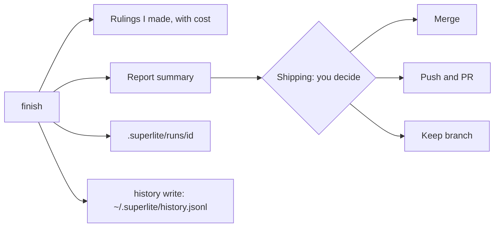

import { FileTree } from "@astrojs/starlight/components";

:::tip[TL;DR]
When the tests are green, `finish` archives the run, lists the decisions superlite made for you, and writes a report that compares the forecast with what happened. Then it asks how to ship. You decide.
:::



## How it works

`superlite-cli finish --plan PLAN` closes the run. It moves the run's files into `.superlite/runs/<id>/`, lists the rulings, and prints a short report summary. In human mode it also prints the approval time.

<FileTree>

- docs/plans/
  - 2026-11-12-csv-export.review.md
  - 2026-11-12-csv-export.md
  - 2026-11-12-csv-export.report.md full report
  - 2026-11-12-csv-export.report.json same data, for tools
- .superlite/runs/ archive of each finished run, never committed

</FileTree>

Three things feed the report. Lint saves a forecast before the first dispatch, so the projection is fixed and cannot drift toward the result. Hooks capture each agent's tokens, cost and time into `.superlite/metrics.jsonl`. Then `superlite-cli history write` appends the run's rows to `~/.superlite/history.jsonl`, which the next run uses for its predictions.

## Example: reading a report

This is the top of a real report, from the build of this docs site. Run `/superlite:report` to list reports, newest first, plus the last 5 history rows. `/superlite:report <plan>` shows the summary, and `/superlite:report <plan> full` shows everything.

```text
# superlite build report

projection: fixed forecast saved at lint 2026-11-12T04:04:54

                         Projected    Actual  Delta
wall-clock (min)               6.8       6.3  -0.5 (-7%)
agent cost (USD, +rework)      1.83      2.66  +0.83 (+45%)
task-minutes                  23.6      23.4  -0.2 (-1%)
agents                          12        19  +7 (+58%)
cost split: agents $2.60, rework $0.06, coordinator $6.81, total $9.47
concurrency: peak 6 at once (projected 6); critical path actual T4 T11; projected T1 > T8 > T12 (6.8 min)
model mix: sonnet 11 tasks $2.60, unknown 1 tasks $0.06, coordinator opus $6.81
quality: tests 36 passed, 0 failed; first-time pass n/a; rework dispatches 1; open incidents 18

task  model      pred  actual  delta             cost
T12   ?           1.8     0.0  -1.8 (-100%)    $0.058
T3    sonnet      1.8     3.3  +1.5 (+85%)     $0.478
T4    sonnet      1.8     3.3  +1.5 (+82%)     $0.407
T2    sonnet      1.8     2.8  +1.0 (+59%)     $0.367
T10   sonnet      1.8     1.0  -0.7 (-42%)     $0.141
(+7 smaller misses; `superlite-cli report --json` lists all)

takeaway: ran 7% faster than projected; cost 45% over; biggest miss T12
```

| Line | What it tells you |
|---|---|
| Projected, Actual, Delta | The forecast, the result, and the difference. A negative delta on time is faster than forecast. |
| wall-clock | Minutes on the clock, start to finish. |
| agent cost (+rework) | Agent spend, including the fix rounds. |
| task-minutes | Minutes of agent work added up. It exceeds wall-clock when agents run side by side. |
| agents | How many agents ran. Fix rounds start extra agents, so this is often above the forecast. |
| cost split | Agents, rework (fixers), and the coordinator. The total is the sum. |
| concurrency | Most agents running at once. The critical path is the longest chain of waiting tasks. It sets the minimum time. |
| model mix | Tasks and cost per model. |
| quality | Tests passed and failed. First-time pass counts tasks that passed with no rework (n/a when none is measured). Rework dispatches are fix rounds. Open incidents are logged problems. |
| task table | The biggest misses between predicted and actual minutes, with cost. A `first-time miss` tag marks tasks that needed rework. |
| takeaway | The whole report in one sentence. |

The full report also has an agent cost table and a line `cost source: est`, meaning the cost is estimated from tokens.

## Good to know

- The report summary prints before any merge or PR option, so you see the cost before you decide.
- Feature runs add a part for the prototype and integration, with the prototype's share against a 25% cap.
- Your rulings are the decisions you did not make yourself. Each shows its cost if wrong, and scope changes also appear under "Changed from the approved plan".

After the report, `superlite:shipping` first asks once whether to commit the finished work to the session branch or leave it uncommitted. It then verifies and asks how to ship: merge locally, push and open a PR, or keep the branch. It never pushes or merges without your answer. Unattended runs keep the branch and do not push, merge or commit. After a PR merges, run `/superlite:merged`. See the [session lifecycle](/superlite/sessions/lifecycle/).

## Next

Back to [human or AI orchestrator](/superlite/run/orchestrators/), or see [how a run starts](/superlite/run/plan-and-approval/).
