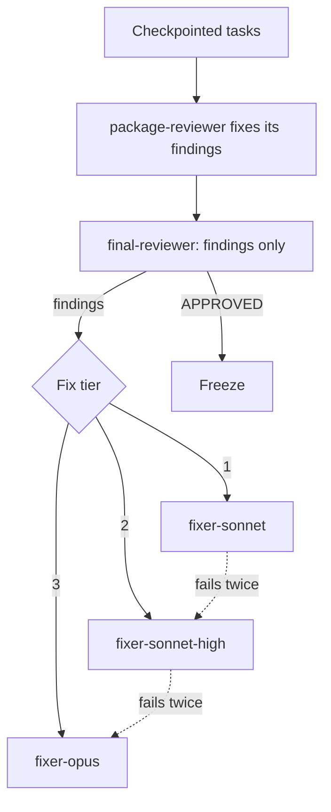

## What you do

Nothing. The coordinator never edits code, and a block message names the fixer tier to use. A red test blocks merge and PR.

## What superlite does

`package-reviewer` reviews a task at checkpoint when it has a seam, Complexity 5 or more, a Review Focus risk or an open incident. Otherwise it reviews once per package, and fixes its own findings.

Then one fresh `final-reviewer` (opus, high) reads a packet and only reports `Verdict: APPROVED` or `CHANGES_REQUESTED` with `file:line - problem - fix - tier N` lines.

| Tier | Agent | Use when |
|---|---|---|
| 1 | `fixer-sonnet` | cause known, one module |
| 2 | `fixer-sonnet-high` | spans modules or a seam |
| 3 | `fixer-opus` | cause unknown, or a lower tier failed twice |

Haiku never fixes, because a fix keeps a decision. After 2 failed rounds at a tier, the fix moves up one. Each failed round is logged as an incident.

Each round rewrites a note `.superlite/fixes/<id>.md`, at most 1,500 characters, ending FIXED or NOT_FIXED. A later round starts a fresh agent that reads only that note.

A fixer fixes only the named findings, adds one regression test per fix and reports a closed list. A note still NOT_FIXED after tier 3 becomes a `Ruling:`.

A Haiku task that ends red, BLOCKED or NEEDS_CONTEXT goes to tier 1 and is never retried on Haiku.

## Example

```text
Verdict: CHANGES_REQUESTED
src/parse.py:42 - drops empty lines - keep them - tier 1
```

Next: [the report](/superlite/run/report/).
