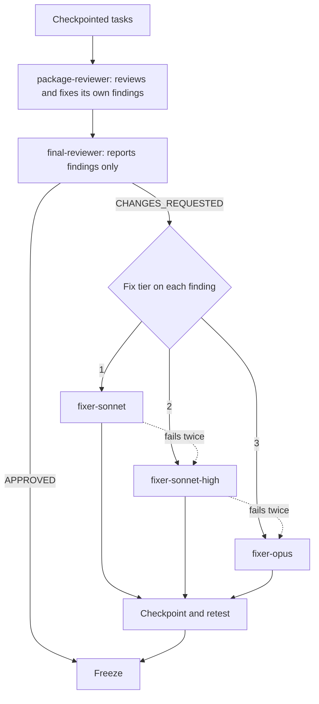
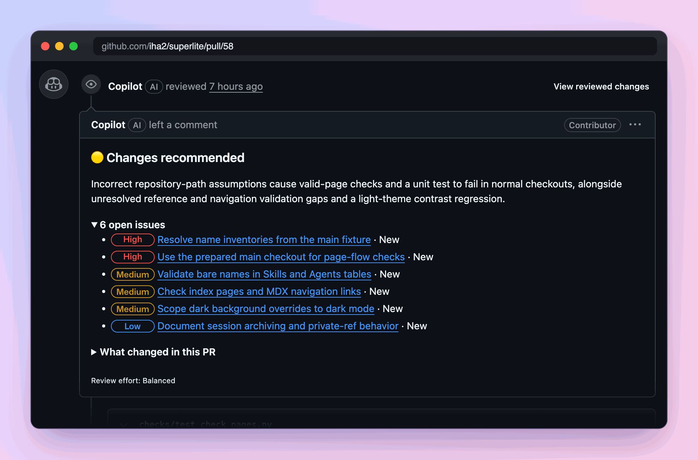
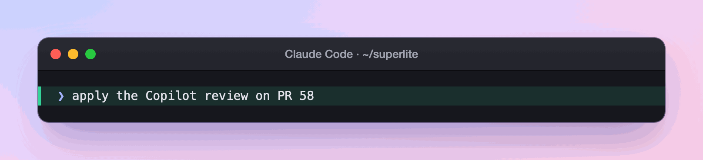
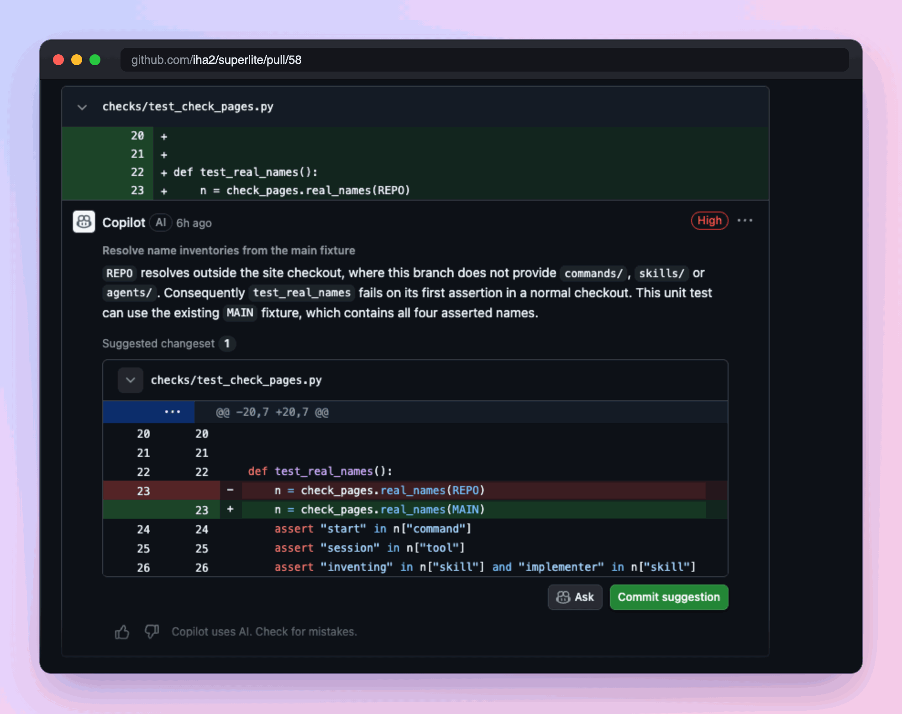
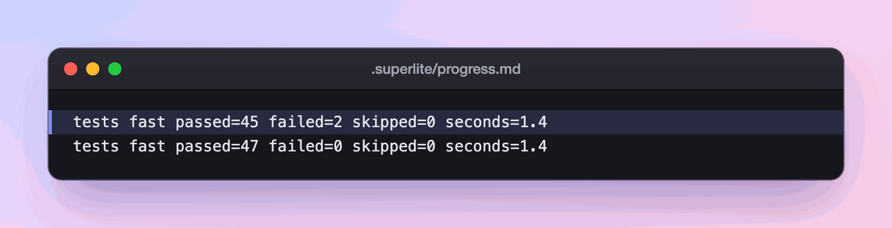
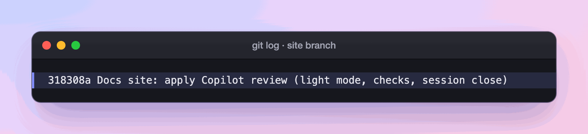

import { Steps } from "@astrojs/starlight/components";

:::tip[TL;DR]
Reviewers find problems and fix-only agents repair them, each with a regression test. Fixes start at the cheapest tier that fits and move up after two failed rounds. The coordinator never edits code.
:::



## How it works

Two reviews, then fixes. Think of a newsroom. An editor checks each story as it lands, and a chief editor reads the whole issue once. Neither rewrites a story the other flagged. A fixer does that.

**Package review.** `package-reviewer` (Sonnet, medium) reviews a task at checkpoint when it has a seam, Complexity 5 or more, a Review Focus risk, or an open incident. Otherwise it reviews once per checkpointed package. It fixes what it finds and closes every finding.

**Final review.** One fresh `final-reviewer` (Opus, high) reads a single packet and answers in one turn. The packet holds incidents, probe failures, the test summary, source excerpts and the plan's Review Focus. Its header says FAST PATH or REVIEW REQUIRED. The reviewer only reports: `Verdict: APPROVED` or `CHANGES_REQUESTED`, plus lines of `file:line - problem - fix - tier N`. The tree stays frozen while it reads.

**Fix tiers.**

| Tier | Agent | Use when |
|---|---|---|
| 1 | `fixer-sonnet` (Sonnet, medium) | cause known, one module |
| 2 | `fixer-sonnet-high` (Sonnet, high) | cause known, but it spans modules or a seam, or is a known probe class |
| 3 | `fixer-opus` (Opus, high) | cause unknown, or a lower tier failed twice |

For example, a wrong path in one test is tier 1, and a bug that spans `package.json`, a script and two tests is tier 2.

Haiku never fixes, because a fix keeps a decision. Haiku stays on mechanical implementation tasks. If one ends red, BLOCKED or NEEDS_CONTEXT, it goes to tier 1 and is never retried on Haiku.

## Example: six review findings on PR #58, fixed in four minutes

<Steps>

1. **You open the PR and see a review.** Copilot, a reviewer outside superlite, has read the docs site PR and posted six findings, each with a severity.

   

   superlite's own final reviewer reports in the same shape, one line per finding: `file:line - problem - fix - tier N`. It only reports, so that the reviewer that judges is never the agent that edits.

2. **You decide:** you hand the review to superlite and let it fix.

   

   The coordinator reads the findings and routes each one. It cannot edit code, so every fix goes to a fix-only agent.

3. **Each finding gets a tier.** Open the first one: a unit test resolves the wrong folder.

   

   The cause is known and sits in one test file, so tier 1, `fixer-sonnet`. The `--main ..` finding spans `package.json`, the checker and two page tests, a seam, so the rules put it at tier 2, `fixer-sonnet-high`.

4. **A fixer works from a note, not a chat.** Each fix keeps its state in `.superlite/fixes/<id>.md`. Here is a real note from this site's later rewrite round.

   ```md title=".superlite/fixes/F-RW-D.md" mark={1}
   # F-RW-D · tier 2 · round 1 · FIXED
   Goal: rewrite site/src/content/docs/run/** as teaching .mdx pages (TL;DR, diagram, Example, Tabs/Steps/FileTree), update test_pages_run.py.
   Tried and failed: root pyproject addopts has -n; run pytest with `-o addopts=` from site/.
   Evidence: pytest checks/test_pages_run.py 10 passed; …
   ```

   If a round fails, it writes `NOT_FIXED`, and a fresh agent starts from the note alone. After two failed rounds the finding moves up a tier. The note stays under 1,500 characters, so a new agent starts with 10 to 20k tokens instead of an old 60 to 100k session.

5. **Only the touched tests run, in the background.** The fix round's ledger holds two runs.

   

   The first run logged two incidents, `test_reference_agent_names_validated` and `test_reference_agent_table_rejects_skill_name`, both new regression tests for the bare-name finding. The fix landed and the second run, 14 seconds later, was green. Each fix adds one regression test that fails without it.

6. **You decide: commit.** Superlite asks at shipping. The six findings became one commit.

   

   Light mode, the `--main` lookup, bare names, index links and session close are the five bullets in the message. The commit came under four minutes after Copilot's review at 04:29.

</Steps>

**What you end up with:** six closed findings, a green test run and one commit on the PR branch. Red tests are findings too. The one blocking run happens at shipping, where red blocks the merge.

## Good to know

- A fixer fixes only the named findings. It does not refactor and does not touch other files.
- After fixes, the coordinator checkpoints again, runs one more background test pass, and freezes.
- Red test lines are findings too. The one blocking test run happens at shipping, and red blocks merge and PR.
- A note still NOT_FIXED after tier 3 becomes a `Ruling:` in the closing message. You see it under "Rulings I made".
- If the coordinator tries to edit code, the block message names the fixer tier to use.

## Next

[The report](/superlite/run/report/) shows what the run cost and how well it went.
