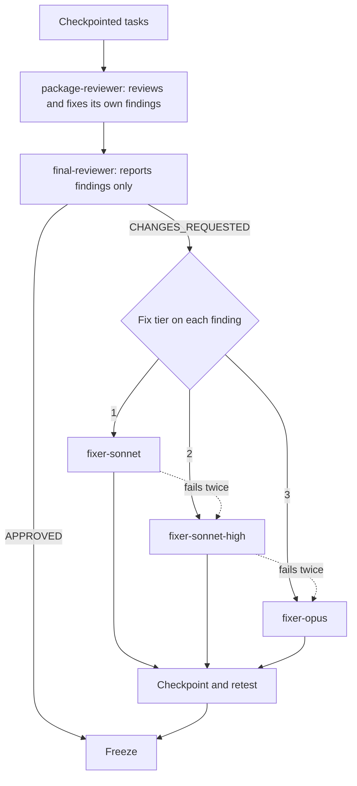

:::tip[TL;DR]
Reviewers find problems and fix-only agents repair them, each with a regression test. Fixes start at the cheapest tier that fits and move up after two failed rounds. The coordinator never edits code.
:::



## How it works

Two reviews, then fixes. Think of a newsroom. An editor checks each story as it lands, and a chief editor reads the whole issue once. Neither rewrites a story the other flagged. A fixer does that.

**Package review.** `package-reviewer` (Sonnet, medium) reviews a task at checkpoint when it has a seam, Complexity 5 or more, a Review Focus risk, or an open incident. Otherwise it reviews once per checkpointed package. It fixes what it finds and closes every finding.

**Final review.** One fresh `final-reviewer` (Opus, high) reads a single packet and answers in one turn. The packet holds incidents, probe failures, the test summary, source excerpts and the plan's Review Focus. Its header says FAST PATH or REVIEW REQUIRED. The reviewer only reports: `Verdict: APPROVED` or `CHANGES_REQUESTED`, plus lines of `file:line - problem - fix - tier N`. The tree stays frozen while it reads.

**Fix tiers.**

| Tier | Agent | Use when |
|---|---|---|
| 1 | `fixer-sonnet` (Sonnet, medium) | cause known, one module |
| 2 | `fixer-sonnet-high` (Sonnet, high) | cause known, but it spans modules or a seam, or is a known probe class |
| 3 | `fixer-opus` (Opus, high) | cause unknown, or a lower tier failed twice |

Haiku never fixes, because a fix keeps a decision. Haiku stays on mechanical implementation tasks. If one ends red, BLOCKED or NEEDS_CONTEXT, it goes to tier 1 and is never retried on Haiku.

## Example: one finding from found to fixed

The final reviewer reports two findings on the CSV export.

```text
Verdict: CHANGES_REQUESTED
src/export.py:42 - fields containing a comma are not quoted - quote them - tier 1
src/export.py:77 - the writer drops the last row of a one-column table - fix the loop exit - tier 1
```

Here is what happens to the first one.

1. The coordinator, which cannot edit code, sends `fixer-sonnet` a brief with a finding id such as `F-T4-1`.
2. The fixer reads the code, fixes line 42, and adds one regression test that fails without the fix.
3. It runs only the touched tests in the background and checkpoints the task.
4. It replies with a closed list, one line per finding.

```text
FIXED - src/export.py:42 - fields containing a comma are not quoted
tests: 14 0 0 run r7
```

When a round fails, the fixer still writes its note. Round 2 is a fresh agent that reads only this note, not the old transcript.

```text
# F-T4-2 · tier 1 · round 2 · NOT_FIXED
Goal: one-column table keeps its last row
Where: src/export.py:70-82
Changed: nothing kept
Tried and failed: slice end - row still dropped - loop exits early
Evidence: test_one_column_last_row - AssertionError
Next: read the loop condition at 74 first
```

After two failed rounds at a tier, the finding moves up one tier. F-T4-2 would go to `fixer-sonnet-high`, again with a fresh agent that reads the note first. Each failed round is logged as an incident. The note is at most 1,500 characters, so a fresh agent starts with 10 to 20k tokens of context instead of an old 60 to 100k session.

## Good to know

- A fixer fixes only the named findings. It does not refactor and does not touch other files.
- After fixes, the coordinator checkpoints again, runs one more background test pass, and freezes.
- Red test lines are findings too. The one blocking test run happens at shipping, and red blocks merge and PR.
- A note still NOT_FIXED after tier 3 becomes a `Ruling:` in the closing message. You see it under "Rulings I made".
- If the coordinator tries to edit code, the block message names the fixer tier to use.

## Next

[The report](/superlite/run/report/) shows what the run cost and how well it went.
