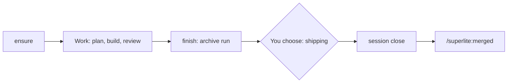

## What you do

1. Start a flow. superlite opens the session.
2. Approve the plan, then let the run work. Use `/superlite:stop` to pause and `/superlite:resume` to continue.
3. At shipping, choose merge, pull request, or keep the branch.
4. After a pull request merges, run `/superlite:merged`.

## What superlite does

`superlite-cli session ensure` runs once the topic is known. Its last line is `SESSION worktree=<path> slug=<s> branch=<b>`. Exit 3 means `REDIRECT`, exit 4 means it needs an answer from you (`ASK`).

During work, `current-run.json` identifies the run, so a repeat ensure on the same topic keeps it. A different topic copies unfinished files to `runs/` and leaves them live.

`superlite-cli finish` moves run files into the archive and marks the session finished.

`session close` then marks it finished, parks run files and puts the main checkout back on the base branch. It removes a parallel worktree it cut. The branch stays. If that worktree held uncommitted work, close parks it and keeps the row. If the base branch is checked out elsewhere, close refuses and changes nothing.

`session use --slug S` switches sessions by hand. It stashes, parks, switches and restores. On a conflict, resolve it, `git add`, then rerun with `--continue`.

## Example

After you merge or keep, shipping runs:

```bash
superlite-cli session close --slug export --keep-branch
```

Afterwards `superlite-cli session status` shows `export` as `run:finished`.

Back to [Sessions](/superlite/sessions/sessions/). All commands are on [Commands](/superlite/start/commands/).
