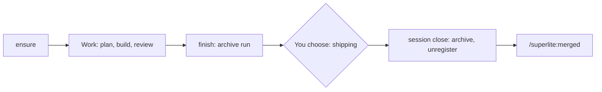

## What you do

1. Start a flow.
2. Approve the plan. Use `/superlite:stop` to pause and `/superlite:resume` to continue.
3. At shipping, choose merge, pull request, or keep the branch.
4. After a pull request merges, run `/superlite:merged`.

## What superlite does

`superlite-cli session ensure` runs once the topic is known. Its last line is `SESSION worktree=<path> slug=<s> branch=<b>`. Exit 3 is `REDIRECT`, exit 4 is `ASK`.

A repeat ensure on the same topic keeps the run. A different topic copies unfinished files to `runs/` and leaves them live.

`superlite-cli finish` moves run files into the archive and marks the session finished.

`session close` archives the session and unregisters it. Run files and a manifest go to `.superlite/session-store/<slug>/`. Uncommitted changes are saved on the private ref `refs/superlite/wip/<slug>`, not your stash list. The rest depends on where the session lives:

- Main checkout: it goes back to the base branch. If that is checked out elsewhere, or a merge or rebase is running, close refuses and changes nothing.
- Worktree superlite cut: its changes are saved the same way, then the worktree is removed. The branch is deleted only if it merged cleanly, nothing was saved and there was no run; `--keep-branch` keeps it. With `--untracked keep` and untracked files present, close saves nothing, leaves the worktree in place and keeps the row.
- Adopted worktree (not cut by superlite): only run files and the row are archived. Its files and branch are untouched; leave it with `ExitWorktree`.

`session use --slug S` switches sessions by hand. On a conflict, resolve it, `git add`, then rerun with `--continue`.

## Example

Shipping runs:

```bash
superlite-cli session close --slug export --keep-branch
```

Close prints `session: closed export; archived to <store>`, plus `(wip <ref>)` if changes were saved. Afterwards `superlite-cli session status` no longer lists `export`.

Back to [Sessions](/superlite/sessions/sessions/). See also [Commands](/superlite/start/commands/).
