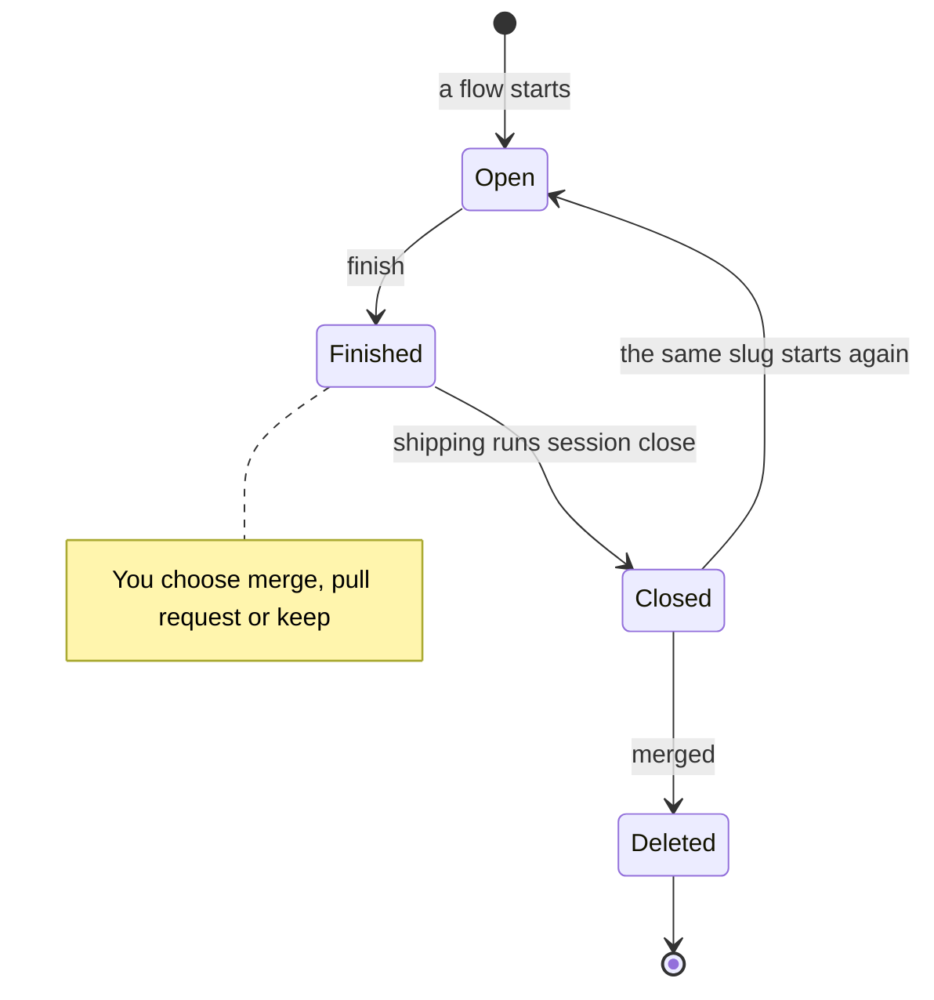
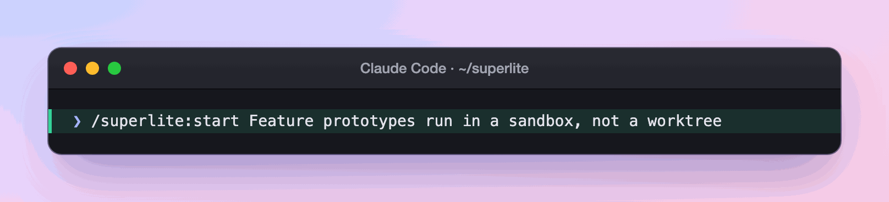
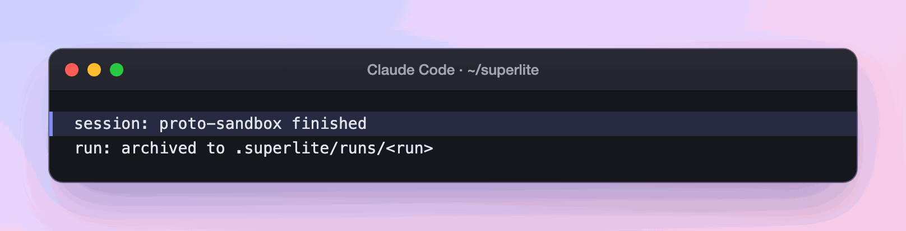
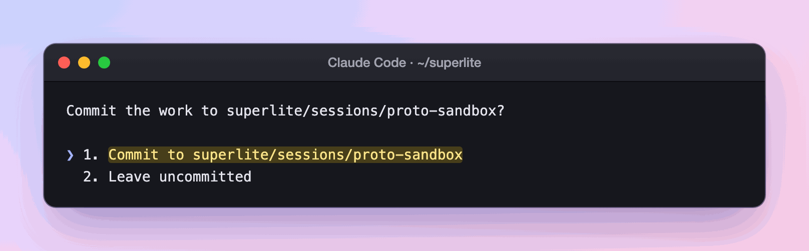
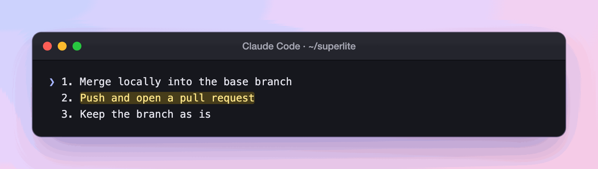
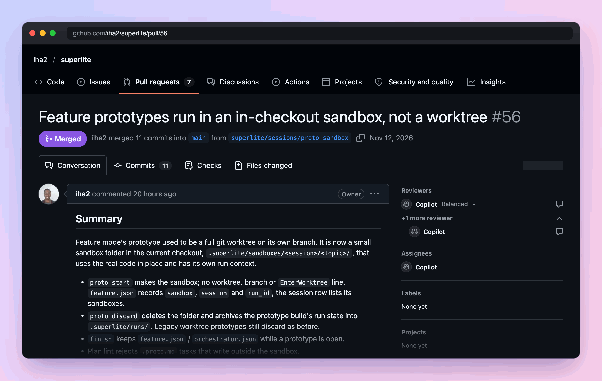
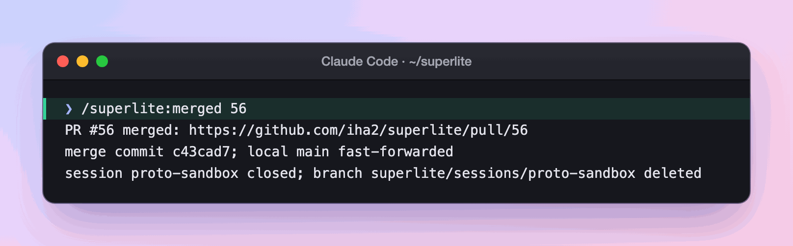

import { FileTree, Steps } from "@astrojs/starlight/components";

:::tip[TL;DR]
A session opens with your flow, is marked finished when the run ends, is closed at shipping, and is deleted after its pull request merges. Closing never loses uncommitted work: it moves to a private git ref.
:::



## How it works

Three steps end a session. Each does one job.

| Step | Who runs it | What it does | Your branch |
|---|---|---|---|
| `superlite-cli finish` | the run, when it ends | Marks the session `run:finished`. Moves the run's files into `.superlite/runs/`. | untouched |
| `superlite-cli session close` | shipping, after you choose | Archives the session and unregisters it. Saves uncommitted work. Puts the checkout back on the base branch. | kept with `--keep-branch`, which shipping passes |
| `/superlite:merged` | you, after a pull request merges | Asks `gh` whether the pull request merged. Fast-forwards local `main`. Closes the session if it is still listed. Deletes its archive and the local branch. | deleted, only if it is the merged one |

`/superlite:merged` never pushes and never touches the remote branch.

### Where uncommitted work goes

A superlite build leaves its work uncommitted. At shipping you choose to commit it to the session branch or leave it. If you leave it, close saves it, tracked files and untracked files, on the private ref `refs/superlite/wip/<slug>`. It does not appear in `git stash list`. Start the same slug again and superlite applies it back; if it cannot apply cleanly, it stays on the ref. `/superlite:merged` asks before it discards work found there.

### What close does, by where the session lived

| Where it lived | What close does |
|---|---|
| Main checkout | Saves the work, parks the run files, switches back to the base branch. If that branch is checked out elsewhere, or a merge or rebase is running, it refuses and changes nothing. |
| Worktree superlite cut | Saves the work the same way, then removes the worktree. It deletes the branch only if the branch merged cleanly, nothing was saved and there was no run. |
| Worktree Claude Code made | Archives the run files and the row. The worktree, its files and its branch stay as they are. Leave it with `ExitWorktree`. |

With `--untracked keep` and untracked files present, close on a worktree superlite cut saves nothing, leaves the worktree in place and keeps the row.

## Example: one session, from request to merged

Take the session behind PR #56, the prototype sandbox change. Its slug is `proto-sandbox`.

<Steps>

1. **You ask for the change.**

   

   Underneath, the flow opens the session (state **Open**): the branch `superlite/sessions/proto-sandbox`, cut from `main`. Plan, build and review all happen on that branch. The build leaves its work uncommitted, by design.

2. **The run ends.** You read the report and see one line about the session.

   

   Underneath, `superlite-cli finish` marks the session **Finished** and moves the run's files into `.superlite/runs/`. Your branch is untouched.

3. **You decide: commit or leave?** Shipping asks once.

   

   Underneath, a commit lands on the session branch only, never on `main`. Without one, the next question offers only "Keep the branch".

   ```mermaid
   gitGraph
     commit id: "main"
     branch "superlite/sessions/proto-sandbox"
     commit id: "the finished work"
   ```

4. **You decide: merge, pull request or keep?** The question carries the test count and the diff summary. PR #56 reported 2,342 tests passed.

   

   Underneath, option 2 pushes the branch and runs `gh pr create` against `main`. Then shipping runs `superlite-cli session close --keep-branch`: the session is **Closed**, `~/superlite` is back on `main`, and the branch stays for the PR.

   <FileTree>

   - superlite/  back on main
     - .superlite/
       - session-store/
         - proto-sandbox/  the archived session, kept until the merge
       - runs/  the finished run

   </FileTree>

5. **The pull request merges on GitHub.** Nothing happens in superlite. The archive and the branch wait.

   

6. **You tell superlite.**

   

   Underneath, `/superlite:merged` asks `gh` whether the pull request really merged and checks that the local branch holds nothing the pull request did not. Only then does it fast-forward `main`, drop the archive and delete the local branch (state **Deleted**). It never pushes and never touches the remote branch.

   ```mermaid
   gitGraph
     commit id: "main"
     branch "superlite/sessions/proto-sandbox"
     commit id: "the finished work"
     checkout main
     merge "superlite/sessions/proto-sandbox"
   ```

</Steps>

**What you end up with:** the change on `main`, the local branch and `session-store/proto-sandbox/` gone, and `.superlite/runs/` still holding the run for the report history. The remote branch is yours to delete. If you had left the work uncommitted, the close line would end with `(wip refs/superlite/wip/proto-sandbox)` and `/superlite:merged` would ask before discarding it.

## Good to know

- Starting the same topic again keeps its run. Starting a different topic copies the unfinished files to `.superlite/runs/` and leaves them live.
- `/superlite:stop` pauses a run and `/superlite:resume` continues it. Neither changes the session.
- `superlite-cli session use --slug S` switches sessions by hand. On a conflict, resolve it, run `git add`, and rerun with `--continue`.
- `superlite-cli session discard --slug S` drops a session's archive, saved work and branch. It is the step `/superlite:merged` uses.

## Next

See where a session works in [Worktrees](/superlite/sessions/worktrees/), or go back to [Sessions](/superlite/sessions/sessions/). Other commands are on [Commands](/superlite/start/commands/).
