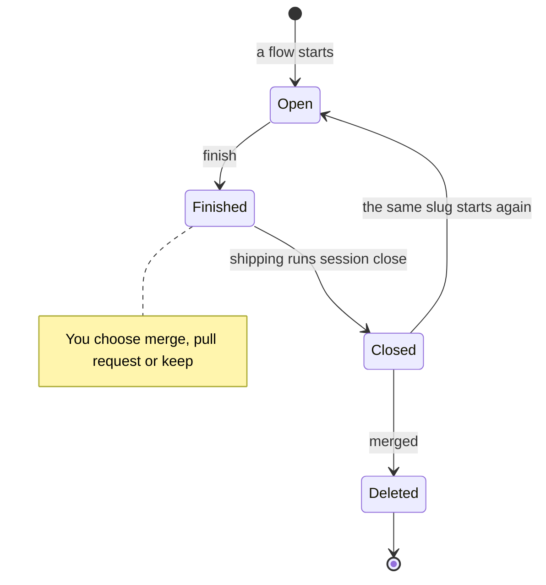

:::tip[TL;DR]
A session opens with your flow, is marked finished when the run ends, is closed at shipping, and is deleted after its pull request merges. Closing never loses uncommitted work: it moves to a private git ref.
:::



## How it works

Three steps end a session. Each does one job.

| Step | Who runs it | What it does | Your branch |
|---|---|---|---|
| `superlite-cli finish` | the run, when it ends | Marks the session `run:finished`. Moves the run's files into `.superlite/runs/`. | untouched |
| `superlite-cli session close` | shipping, after you choose | Archives the session and unregisters it. Saves uncommitted work. Puts the checkout back on the base branch. | kept with `--keep-branch`, which shipping passes |
| `/superlite:merged` | you, after a pull request merges | Asks `gh` whether the pull request merged. Fast-forwards local `main`. Closes the session if it is still listed. Deletes its archive and the local branch. | deleted, only if it is the merged one |

`/superlite:merged` never pushes and never touches the remote branch.

### Where uncommitted work goes

A superlite build leaves its work uncommitted. At shipping you choose to commit it to the session branch or leave it. If you leave it, close saves it, tracked files and untracked files, on the private ref `refs/superlite/wip/<slug>`. It does not appear in `git stash list`. Start the same slug again and superlite applies it back; if it cannot apply cleanly, it stays on the ref. `/superlite:merged` asks before it discards work found there.

### What close does, by where the session lived

| Where it lived | What close does |
|---|---|
| Main checkout | Saves the work, parks the run files, switches back to the base branch. If that branch is checked out elsewhere, or a merge or rebase is running, it refuses and changes nothing. |
| Worktree superlite cut | Saves the work the same way, then removes the worktree. It deletes the branch only if the branch merged cleanly, nothing was saved and there was no run. |
| Worktree Claude Code made | Archives the run files and the row. The worktree, its files and its branch stay as they are. Leave it with `ExitWorktree`. |

With `--untracked keep` and untracked files present, close on a worktree superlite cut saves nothing, leaves the worktree in place and keeps the row.

## Example: from request to merged

```text
you        /superlite:feature Add CSV export
superlite  SESSION worktree=/work/shop slug=export branch=superlite/sessions/export
superlite  plan, build, review; the report is written
superlite  session: export finished
superlite  asks: commit the work to superlite/sessions/export, or leave it uncommitted?
you        commit
superlite  asks: merge, open a pull request, or keep the branch?
you        open a pull request
superlite  session: closed export; archived to /work/shop/.superlite/session-store/export; /work/shop is back on main
           ... days later, the pull request is merged on GitHub ...
you        /superlite:merged
superlite  confirms the merge with gh, fast-forwards main, deletes the session archive and the local branch
```

After the close line, `superlite-cli session status` no longer lists `export`. If you had left the work uncommitted, the close line would end with `(wip refs/superlite/wip/export)` before the last clause.

## Good to know

- Starting the same topic again keeps its run. Starting a different topic copies the unfinished files to `.superlite/runs/` and leaves them live.
- `/superlite:stop` pauses a run and `/superlite:resume` continues it. Neither changes the session.
- `superlite-cli session use --slug S` switches sessions by hand. On a conflict, resolve it, run `git add`, and rerun with `--continue`.
- `superlite-cli session discard --slug S` drops a session's archive, saved work and branch. It is the step `/superlite:merged` uses.

## Next

See where a session works in [Worktrees](/superlite/sessions/worktrees/), or go back to [Sessions](/superlite/sessions/sessions/). Other commands are on [Commands](/superlite/start/commands/).
