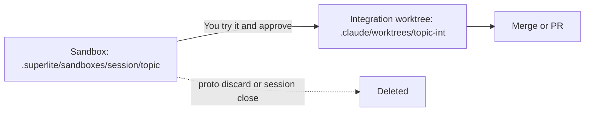

## What you do

In feature mode, try the prototype and answer in plain text: "it works", or list changes. Changes start a fix round on the same sandbox.

## What superlite does

The prototype lives in a folder, `.superlite/sandboxes/<session>/<topic>/`. It is not a worktree and not a branch. `<session>` is `host` when there is no session.

- Your tracked files are never touched.
- The sandbox keeps the app's entry point and what the feature touches. The rest is stubbed.
- Its plan stays inside the sandbox: at most 8 tasks.
- `superlite-cli proto tryout` prints how to run it and the acceptance checks.
- In human mode, integration stays blocked until you approve the try-out.
- Integration is ported task by task, never merged. The prototype's stubs stay behind.
- Sessions never move sandboxes when you switch.

`superlite-cli proto discard` deletes the sandbox and archives its run files. `session close` discards an open sandbox too.

## Example

Start the prototype for a topic:

```bash
superlite-cli proto start --topic export --run "npm run dev"
```

The folder appears at `.superlite/sandboxes/<session>/export/`, where `<session>` is your session slug. Run `superlite-cli proto tryout` to see how to reach it.

See the [Feature flow](/superlite/flows/feature/) and [Worktrees](/superlite/sessions/worktrees/).
