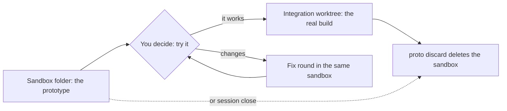

import { FileTree, Steps } from "@astrojs/starlight/components";

:::tip[TL;DR]
A sandbox is a plain folder where the feature flow builds a throwaway prototype for you to try. It is not a worktree and not a branch. It never edits your tracked files, and superlite deletes it when the feature is done.
:::



## How it works

Before a feature touches your real code, you get something to try. The prototype is the smallest runnable piece of your app that shows the feature working. It keeps the entry point and what the feature touches, and stubs the rest: a fake database, a fixed test user, fake services. For a CSV export, that is a tiny app with the export button and a fake list of orders.

It lives in one folder inside your checkout:

<FileTree>

- .superlite/
  - feature.json  topic, status and run command of the open prototype
  - sandboxes/
    - csv-export/  the session slug, or `host` when there is no session
      - csv-export/  the topic
        - docs/plans/  the prototype's own plan, at most 8 tasks
        - tests/  written against the feature's acceptance checks
        - src/  new code and stand-ins, in your project's own layout

</FileTree>

### Real code, no edits

The sandbox holds only new code and stand-ins. It reaches your real code where it already is, so nothing is copied and nothing is edited. It sees your uncommitted code too.

| Language | How the sandbox reaches your code |
|---|---|
| Python | `PYTHONPATH`, or a `sys.path` entry pointing at your source |
| Node | `tsconfig` `paths`, or a relative import out of the sandbox |
| Go | a `replace` directive in the sandbox's `go.mod` |
| Rust | a path dependency in `Cargo.toml` |

Stand-ins are injected at the sandbox's entry point. A real file is copied only when it hard-wires a dependency that cannot be injected, and the plan says so.

### Sandbox or worktree?

| | Sandbox | Worktree |
|---|---|---|
| What it is | A plain folder | A second checkout git knows about |
| Where | `.superlite/sandboxes/<session>/<topic>/` | `.claude/worktrees/<name>/` |
| Branch | None | Its own |
| Holds | A small app with stubs | Your whole project |
| Used for | The throwaway prototype | Sessions and the real integration build |
| Your tracked files | Never touched | Edited on its own branch |
| Deleted by | `proto discard` or `session close` | `session close`, or `ExitWorktree` for Claude's |
| Moves when sessions switch | Never | Never |

The two meet at one point. The prototype's code is ported to the integration worktree task by task, never merged, so stubs and fakes stay behind.

## Example: trying People you may know

Say your social network lives in `~/social` and you want to suggest "People you may know" from friends of friends. It is a feature, so you try it before the real code changes.

<Steps>

1. **You ask for the feature and approve its plan.**

   ```text frame="terminal" title="Claude Code · ~/social" ins={1}
   ❯ /superlite:feature Suggest "People you may know" from friends of friends
   ```

   The plan has a "Prototype scope" section. It says how real the prototype must be, here one that keeps the app's entry point, feed and profile pages and stubs the friends database. It also lists what to keep and what to stub.

2. **superlite builds the prototype.** You wait. superlite makes the sandbox folder and builds the prototype inside it. Nothing outside the folder is written.

   <FileTree>

   - ~/social/
     - .superlite/
       - sandboxes/
         - people-you-may-know/  the session
           - people-you-may-know/  the topic
             - app/  the social app's entry point, feed and profile pages
             - proto/  new code: suggestion query, "People you may know" card, Dismiss button
             - stubs/  friends database and notifications, faked
             - tests/  written from the acceptance checks
             - package.json  npm run dev starts it

   </FileTree>

3. **You decide: try it.** superlite prints how to reach the prototype and the acceptance checks. You run the command it gives.

   ```text frame="terminal" title="Try-out · ~/social/.superlite/sandboxes/people-you-may-know/people-you-may-know" ins={1} mark={2,6}
   ❯ npm run dev
   social (sandbox): http://localhost:3000/feed
   suggestions: 4 people you may know
   friends database: stubbed
   ...
   social files changed: none
   ```

   The command starts the sandbox app and prints the address to open. You open the feed, see the "People you may know" card, click Dismiss and reload, as the acceptance checks say. The last line proves the point of a sandbox: no app file was touched.

4. **You decide: it works, or change it.** You reply in plain text. Say you ask for one round of changes first.

   ```text frame="terminal" title="Claude Code · ~/social" ins={1}
   ❯ <what you want different>
   ```

   A change request starts a fix round in the same sandbox, not a new plan, and then another try-out. Replying that it works records your approval. In human mode the real build stays blocked until you give it.

5. **The real feature gets its own worktree.** The integration build runs in `.claude/worktrees/sessions-people-you-may-know-int` (see [Worktrees](/superlite/sessions/worktrees/)). The prototype's acceptance tests are ported as unit tests, task by task. Stubs stay behind.

   <FileTree>

   - ~/social/
     - .claude/worktrees/sessions-people-you-may-know-int/  the real build
     - .superlite/sandboxes/people-you-may-know/  deleted at the end

   </FileTree>

6. **superlite cleans up.** At the end of the feature, `superlite-cli proto discard` deletes the sandbox and archives its run files. If it was left open, `session close` removes it.

</Steps>

**What you end up with:** a branch `superlite/sessions/people-you-may-know-int` ready for a pull request, with only the real code and the ported tests, a prototype you tried before any of it was written, and no stubs or fakes on your branch.

## Good to know

- In human mode the integration build stays blocked until you approve the try-out.
- Your reply to the try-out is plain text: "it works", or a list of changes. Changes start a fix round, not a new plan.
- The default is stubs for everything the feature does not change. When the feature depends on real data shapes, the plan can ask for an isolated environment with seeded fixtures and test values instead of secrets.
- Real secrets and production data never enter a sandbox.
- `proto discard` keeps the prototype's report headline and archives its run files. `session close` discards an open sandbox too.

## Next

Read the [Feature flow](/superlite/flows/feature/), or see where the integration build runs in [Worktrees](/superlite/sessions/worktrees/).
