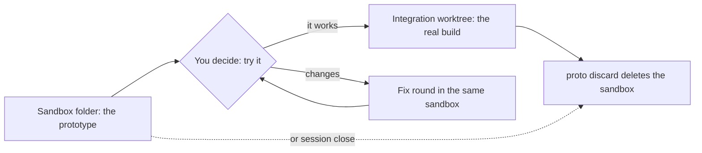

import { FileTree } from "@astrojs/starlight/components";

:::tip[TL;DR]
A sandbox is a plain folder where the feature flow builds a throwaway prototype for you to try. It is not a worktree and not a branch. It never edits your tracked files, and superlite deletes it when the feature is done.
:::



## How it works

Before a feature touches your real code, you get something to try. The prototype is the smallest runnable piece of your app that shows the feature working. It keeps the entry point and what the feature touches, and stubs the rest: a fake database, a fixed test user, fake services.

It lives in one folder inside your checkout:

<FileTree>

- .superlite/
  - feature.json  topic, status and run command of the open prototype
  - sandboxes/
    - csv-export/  the session slug, or `host` when there is no session
      - csv-export/  the topic
        - docs/plans/  the prototype's own plan, at most 8 tasks
        - tests/  written against the feature's acceptance checks
        - src/  new code and stand-ins, in your project's own layout

</FileTree>

### Real code, no edits

The sandbox holds only new code and stand-ins. It reaches your real code where it already is, so nothing is copied and nothing is edited. It sees your uncommitted code too.

| Language | How the sandbox reaches your code |
|---|---|
| Python | `PYTHONPATH`, or a `sys.path` entry pointing at your source |
| Node | `tsconfig` `paths`, or a relative import out of the sandbox |
| Go | a `replace` directive in the sandbox's `go.mod` |
| Rust | a path dependency in `Cargo.toml` |

Stand-ins are injected at the sandbox's entry point. A real file is copied only when it hard-wires a dependency that cannot be injected, and the plan says so.

### Sandbox or worktree?

| | Sandbox | Worktree |
|---|---|---|
| What it is | A plain folder | A second checkout git knows about |
| Where | `.superlite/sandboxes/<session>/<topic>/` | `.claude/worktrees/<name>/` |
| Branch | None | Its own |
| Holds | A small app with stubs | Your whole project |
| Used for | The throwaway prototype | Sessions and the real integration build |
| Your tracked files | Never touched | Edited on its own branch |
| Deleted by | `proto discard` or `session close` | `session close`, or `ExitWorktree` for Claude's |
| Moves when sessions switch | Never | Never |

The two meet at one point. The prototype's code is ported to the integration worktree task by task, never merged, so stubs and fakes stay behind.

## Example: trying a CSV export

```text
you        /superlite:feature Add CSV export
superlite  reads the code, writes a feature plan; you approve it
superlite  superlite-cli proto start --topic csv-export --run "npm run dev"
superlite  builds the prototype in .superlite/sandboxes/csv-export/csv-export/
superlite  superlite-cli proto tryout prints how to run it and the acceptance checks
you        the button should sit in the toolbar
superlite  a fix round in the same sandbox, then another try-out
you        it works
superlite  builds the real feature in an integration worktree
superlite  superlite-cli proto discard deletes the sandbox
```

## Good to know

- In human mode the integration build stays blocked until you approve the try-out.
- Your reply to the try-out is plain text: "it works", or a list of changes. Changes start a fix round, not a new plan.
- The default is stubs for everything the feature does not change. When the feature depends on real data shapes, the plan can ask for an isolated environment with seeded fixtures and test values instead of secrets.
- Real secrets and production data never enter a sandbox.
- `proto discard` keeps the prototype's report headline and archives its run files. `session close` discards an open sandbox too.

## Next

Read the [Feature flow](/superlite/flows/feature/), or see where the integration build runs in [Worktrees](/superlite/sessions/worktrees/).
