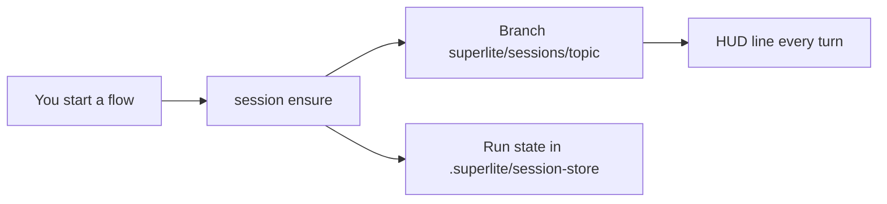

## What you do

Start any flow. Say what you want, and superlite names the topic.

You never type `session create`. Check where you are with `superlite-cli session status`, which lists each session as `run:open` or `run:finished`.

## What superlite does

A session is one line of work: a branch `superlite/sessions/<slug>`, parked run state, and an optional stash of your uncommitted files.

Why it exists: two chats in one folder would overwrite `.superlite/`. Sessions keep them apart.

- Slugs use a-z, 0-9 and `-`. A taken slug becomes `-2`, `-3`.
- Dirty files are stashed only with your OK. superlite asks once with `ASK untracked`.
- Every turn shows a one-line HUD. It adds `main:+N` when local main moved ahead.
- Nothing syncs by itself. `session sync` only fast-forwards and never pushes or rebases.

Set `SUPERLITE_NO_AUTO_SESSION=1` to turn auto-start off, or `SUPERLITE_NO_SESSION_HUD=1` to hide the HUD.

Next: [Session lifecycle](/superlite/sessions/lifecycle/), [Worktrees](/superlite/sessions/worktrees/) and the feature [sandbox](/superlite/sessions/sandbox/). Commands are on [Commands](/superlite/start/commands/).

## Example

The HUD line you see on each turn:

```text
superlite session: export | branch superlite/sessions/export | worktree …/host | active | stash:no | run:open
```

In the main checkout with no session it reads `superlite session: none here (main checkout) | <N> sessions`.
