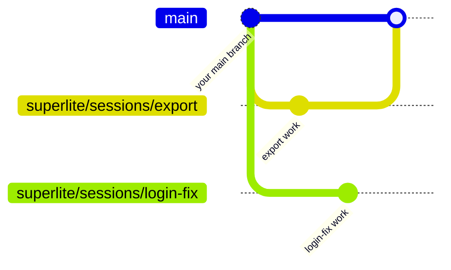

import { FileTree } from "@astrojs/starlight/components";

:::tip[TL;DR]
A session is one piece of work: a git branch plus the run state superlite keeps for it in `.superlite/`. Every flow opens one for you, so two chats on one project never overwrite each other.
:::



## How it works

A session bundles three things:

- **A branch**, `superlite/sessions/<slug>`, cut from the branch you were on. The work lands there, never on `main`.
- **Run state**: the plan, the progress ledger and the checkpoints. It lives in the `.superlite/` folder of the checkout the session works in.
- **Saved files**, only if you agree: uncommitted work set aside when a session has to make room for another.

The slug is the topic in `a-z`, `0-9` and `-`. A taken slug becomes `-2`, `-3`. The word `host` is reserved.

Why bother? Two chats in one folder write to the same `.superlite/` and wreck each other's state. A session gives each piece of work its own branch and its own run state. Sessions share your main checkout and take turns by default. superlite parks the idle session's run files, then restores them when it becomes active again. When two chats must run at the same time, the second one gets its own folder, a [worktree](/superlite/sessions/worktrees/).

One `.superlite/` holds the shared bookkeeping. Git never shows it, because superlite lists it in `.git/info/exclude`.

<FileTree>

- .superlite/
  - sessions.json  every session and where it lives
  - sessions.lock  held while that list is written, so chats never lose each other's rows
  - current-run.json  which run is live in this folder
  - session-store/
    - login-fix/  run files of a session that is parked or closed
  - runs/  archived runs, never moved by sessions
  - sandboxes/  [prototype folders](/superlite/sessions/sandbox/)

</FileTree>

## Example: two chats, one project

You start a feature in one chat. While it is open, you start a bug fix in a second chat.

```text
chat 1     /superlite:feature Add CSV export
superlite  SESSION worktree=/work/shop slug=export branch=superlite/sessions/export
chat 2     /superlite:debug Login redirect loops
superlite  ASK move slug=export: export moves from the main checkout to /work/shop/.claude/worktrees/sessions-export; its chat must be idle
you        yes
superlite  session: moved export -> /work/shop/.claude/worktrees/sessions-export
superlite  session: created parallel login-fix -> /work/shop/.claude/worktrees/sessions-login-fix on superlite/sessions/login-fix
superlite  SESSION worktree=/work/shop/.claude/worktrees/sessions-login-fix slug=login-fix branch=superlite/sessions/login-fix
```

Both sessions now have a folder and a branch, and `/work/shop` is back on `main`. What the `ASK move` question means is on [Worktrees](/superlite/sessions/worktrees/). To list sessions at any time, run `superlite-cli session status`:

```text
session: active=- host=/work/shop
session: parallel export | branch superlite/sessions/export | worktree /work/shop/.claude/worktrees/sessions-export | stash:no | run:open
session: parallel login-fix | branch superlite/sessions/login-fix | worktree /work/shop/.claude/worktrees/sessions-login-fix | stash:no | run:open
```

## Good to know

- Every turn starts with a one-line status of the session you are in, for example `superlite session: export | branch superlite/sessions/export | worktree …/host | active | stash:no | run:open`. When local `main` has moved ahead, it adds `main:+N`.
- Nothing syncs by itself. `superlite-cli session sync` only fast-forwards to your local `main`. It never fetches, pushes, pulls or rebases, and it never makes a merge commit.
- Untracked files are set aside only with your OK. superlite asks once: stash them with the session, keep them in the folder, or always do one of those.
- Set `SUPERLITE_NO_AUTO_SESSION=1` to stop flows from opening sessions. Set `SUPERLITE_NO_SESSION_HUD=1` to hide the status line.

## Next

[Session lifecycle](/superlite/sessions/lifecycle/) shows how a session ends. [Worktrees](/superlite/sessions/worktrees/) shows where a second chat works. Commands are on [Commands](/superlite/start/commands/).
