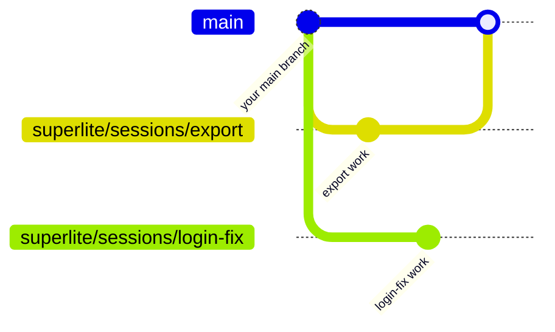
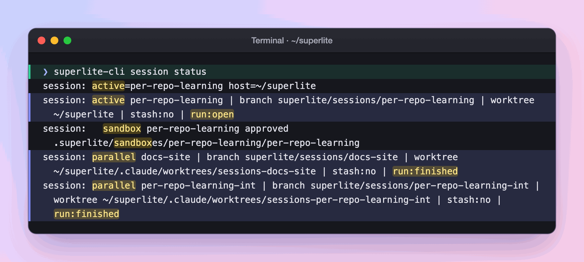

import { FileTree, Steps } from "@astrojs/starlight/components";

:::tip[TL;DR]
A session is one piece of work: a git branch plus the run state superlite keeps for it in `.superlite/`. Every flow opens one for you, so two chats on one project never overwrite each other.
:::



## How it works

A session bundles three things:

- **A branch**, `superlite/sessions/<slug>`, cut from the branch you were on. The work lands there, never on `main`.
- **Run state**: the plan, the progress ledger and the checkpoints. It lives in the `.superlite/` folder of the checkout the session works in.
- **Saved files**, only if you agree: uncommitted work set aside when a session has to make room for another.

The slug is the topic in `a-z`, `0-9` and `-`. A request to add CSV export gets the slug `export` and the branch `superlite/sessions/export`. A taken slug becomes `-2`, `-3`. The word `host` is reserved.

Why bother? Two chats in one folder write to the same `.superlite/` and wreck each other's state. A session gives each piece of work its own branch and its own run state. Sessions share your main checkout and take turns by default. superlite parks the idle session's run files, then restores them when it becomes active again. When two chats must run at the same time, the second one gets its own folder, a [worktree](/superlite/sessions/worktrees/).

One `.superlite/` holds the shared bookkeeping. Git never shows it, because superlite lists it in `.git/info/exclude`.

<FileTree>

- .superlite/
  - sessions.json  every session and where it lives
  - sessions.lock  held while that list is written, so chats never lose each other's rows
  - current-run.json  which run is live in this folder
  - session-store/
    - login-fix/  run files of a session that is parked or closed
  - runs/  archived runs, never moved by sessions
  - sandboxes/  [prototype folders](/superlite/sessions/sandbox/)

</FileTree>

## Example: two chats on one project

Say your social app lives in `~/social`. You work on a feature in one chat and a bug fix in another, at the same time.

<Steps>

1. **Chat 1: you ask for a feature.**

   ```text frame="terminal" title="Chat 1 · ~/social" ins={1}
   ❯ /superlite:feature Add CSV export
   ● Reading the code and writing a plan...
   ```

   Underneath, the flow opens a session before it plans anything. It cuts the branch `superlite/sessions/export` from `main` and keeps the plan, ledger and checkpoints in the `.superlite/` folder of `~/social`. The session is how a later chat finds this work and leaves it alone.

   <FileTree>

   - social/  on branch superlite/sessions/export
     - .superlite/  chat 1's run state
     - src/

   </FileTree>

2. **Chat 2: you report a bug.** Chat 1 is still open and `~/social` is its folder.

   ```text frame="terminal" title="Chat 2 · ~/social" ins={1}
   ❯ /superlite:debug Login redirect loops
   ```

   Underneath, two chats in `~/social` would overwrite each other's `.superlite/` and switch each other's branch. superlite does not guess. It stops and asks, and changes nothing until you answer.

3. **You decide: move chat 1 out?** The question names the folder `export` would move to and says its chat must be idle.

   ```text frame="terminal" title="Chat 2 · ~/social" mark={4} "Yes"
   Move session export out of the main checkout into
   ~/social/.claude/worktrees/sessions-export? Its chat must be idle.

   ❯ 1. Yes
     2. No
   ```

   Answer yes when chat 1 is waiting on you, not working. Answer no and chat 2 does not start. [Worktrees](/superlite/sessions/worktrees/) covers this question in full.

4. **superlite moves the work.** Underneath, it gives `export` a [worktree](/superlite/sessions/worktrees/) with its run files and uncommitted work, gives `login-fix` its own, and puts `~/social` back on `main`. If any step fails, it puts everything back.

   <FileTree>

   - social/  on branch main
     - .claude/
       - worktrees/
         - sessions-export/  chat 1 now works here
         - sessions-login-fix/  chat 2 works here

   </FileTree>

5. **Each chat sees only its own folder.** Every turn in each chat starts with a status line about its own session:

   ```text frame="terminal" title="Chat 1 · ~/social/.claude/worktrees/sessions-export"
   superlite session: export | branch superlite/sessions/export | worktree ~/social/.claude/worktrees/sessions-export | active | stash:no | run:open
   ❯
   ```

   ```text frame="terminal" title="Chat 2 · ~/social/.claude/worktrees/sessions-login-fix"
   superlite session: login-fix | branch superlite/sessions/login-fix | worktree ~/social/.claude/worktrees/sessions-login-fix | active | stash:no | run:open
   ❯
   ```

   A fix in one never shows up in the other, because the files are different copies. They share one git history and one `sessions.json`, so each session still sees the other's row.

6. **You check on both.** Run `superlite-cli session status` in either chat to list every session:

   

   *Real output: session status in the superlite repo itself, not the social app. One session is active in the checkout, with a sandbox listed under it. Two are parallel, in their own worktrees, and their runs are finished.*

   Your two chats print the same kind of lines: one `parallel` row for `export` and one for `login-fix`, each with `run:open`.

</Steps>

**What you end up with:** two branches, two folders and two sets of run state, each owned by one chat. `main` is untouched. When a chat finishes, its session [ends on its own](/superlite/sessions/lifecycle/).

## Good to know

- Every turn starts with a one-line status of the session you are in, for example `superlite session: export | branch superlite/sessions/export | worktree …/host | active | stash:no | run:open`. When local `main` has moved ahead, it adds `main:+N`.
- Nothing syncs by itself. `superlite-cli session sync` only fast-forwards to your local `main`. It never fetches, pushes, pulls or rebases, and it never makes a merge commit.
- Untracked files are set aside only with your OK. superlite asks once: stash them with the session, keep them in the folder, or always do one of those.
- Set `SUPERLITE_NO_AUTO_SESSION=1` to stop flows from opening sessions. Set `SUPERLITE_NO_SESSION_HUD=1` to hide the status line.

## Next

[Session lifecycle](/superlite/sessions/lifecycle/) shows how a session ends. [Worktrees](/superlite/sessions/worktrees/) shows where a second chat works. Commands are on [Commands](/superlite/start/commands/).
