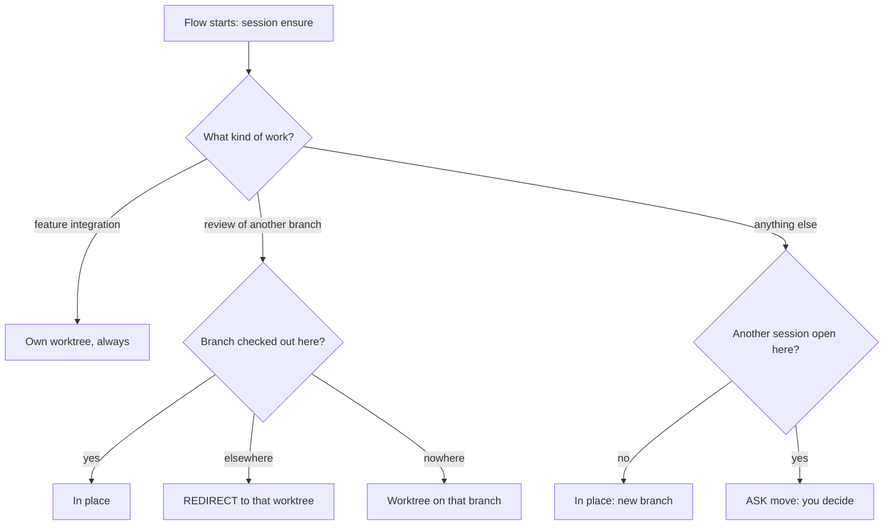
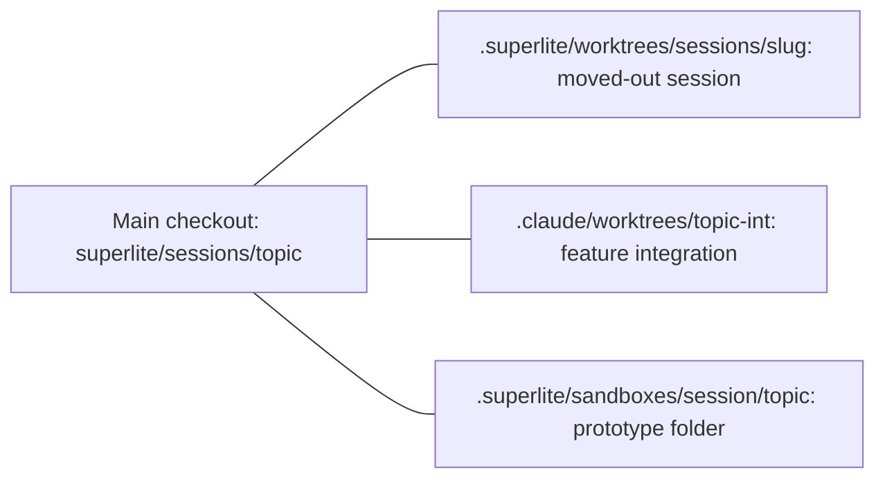

## What you do

Answer when asked. A worktree is a second folder on its own branch.

- On `ASK move`, choose "Move it" or "Not now".
- Under Claude Code, call `EnterWorktree` with the printed `name=` or `path=`, then rerun the same command inside.
- On `ASK branch-name`, pick `worktree`, `superlite` or your own pattern with `{slug}`.
- Elsewhere, `cd` to the `SESSION worktree=<path>` line.

## What superlite does

Sessions share your main checkout by default. A second worktree is only for parallel chats.

- No session, or the active one is finished: a new branch in place.
- Same topic already open here: keeps its run.
- Another session open here: `ASK move`. "Move it" sends the open session, with its files, to `.superlite/worktrees/sessions/<s>`. The new topic takes the main checkout. "Not now" changes nothing.
- Open session is on the base branch: it stays. Only the new session gets a worktree, with no question.
- Review of another branch: `ensure --branch <target>`.
- Feature integration: always its own worktree and branch. One feature, one worktree.

Fresh worktrees live under `<hub>/.claude/worktrees/`. A moved-out session goes to `.superlite/worktrees/sessions/<s>`. The [sandbox](/superlite/sessions/sandbox/) is a folder, not a worktree. `session close` removes a worktree superlite cut. `ExitWorktree` never does. A Claude-created worktree ends with `ExitWorktree` `remove` or `keep`.

## Example

Feature integration cuts its worktree:

```bash
superlite-cli session create --slug export-int --worktree
```

You see `session: create EnterWorktree name=<n> base=<ref>`. Call `EnterWorktree`, then rerun the command inside it.

See [Sessions](/superlite/sessions/sessions/), the [lifecycle](/superlite/sessions/lifecycle/) and the [Feature flow](/superlite/flows/feature/).
