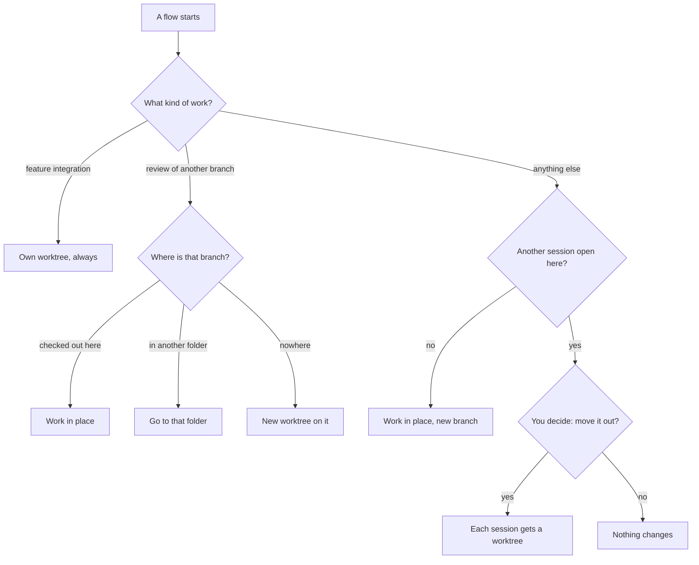

import { FileTree, Steps } from "@astrojs/starlight/components";

:::tip[TL;DR]
A worktree is a second desk: another folder with its own copy of the project, on its own branch, sharing one git history. superlite sets one up only when two pieces of work would collide, and for a feature's integration build.
:::



## How it works

Think of your project folder as a desk. A branch is the job laid out on it. Switching jobs means clearing the desk. A worktree gives you a second desk: git checks out another branch into another folder, and both desks share one history. Two chats can then work at once without touching each other's files. For example, a docs rewrite and a bug fix each get a folder, and neither sees the other's half-finished edits.

By default superlite uses one desk. Sessions take turns in your main checkout. It adds a desk in two cases: a second chat starts while the first session is open, and a feature reaches its integration build. Worktrees live under `.claude/worktrees/`, which git never shows because superlite lists it in `.git/info/exclude`.

<FileTree>

- social/  your main checkout
  - .claude/
    - worktrees/
      - sessions-export/  a session superlite moved out
      - sessions-login-fix/  a session superlite cut
      - export-int/  a feature's integration build
      - merge-main/  temporary, while shipping merges
  - .superlite/
    - sandboxes/  not worktrees: [prototype folders](/superlite/sessions/sandbox/)

</FileTree>

Older sessions may sit under `.superlite/worktrees/sessions/<slug>`. They keep working.

### The move question

When a new flow starts and your main checkout holds an open session, superlite does not touch that session on its own. It asks first, and changes nothing until you answer:

```text
ASK move slug=export: export moves from the main checkout to /work/social/.claude/worktrees/sessions-export; its chat must be idle
```

- **Yes** moves `export`, with its run files and uncommitted work, into its own worktree. Your main checkout goes back to the base branch, and the new topic gets a worktree too. If anything fails, superlite puts everything back.
- **No** stops here. Nothing changes, and the new session does not start. Finish or close the open session, then start again.

Answer yes only when the first chat is idle, because its files move. superlite may first ask what to do with untracked files: stash them with the session, or keep them in the main checkout.

If the open session is already on the base branch, it stays, and only the new session gets a worktree. superlite asks nothing.

### The integration worktree

A feature runs twice. The prototype lives in a [sandbox](/superlite/sessions/sandbox/), a plain folder. After you approve it, the integration build gets its own worktree, named after the topic with `-int`.

### Entering a worktree under Claude Code

A new worktree is a different folder, so your chat has to step into it. Follow the line superlite prints:

<Steps>

1. `session: create EnterWorktree name=<n> base=<ref>`: Claude Code makes the worktree. Call `EnterWorktree name=<n>`, then rerun the same command inside it. superlite adopts the worktree.
2. `session: enter EnterWorktree path=<abs>`: superlite already cut it, for example because your main checkout is not on the base. Call `EnterWorktree path=<abs>`.
3. `ASK branch-name`: asked once. Keep Claude's `worktree-<slug>`, use `superlite/sessions/<slug>`, or give a pattern with `{slug}`.

</Steps>

Other tools: `cd` to the path on the `SESSION worktree=` line.

## Example: this docs session moves to its own desk

This docs site was built in a session called `docs-site`, in the main checkout `~/superlite`, on the branch `superlite/sessions/docs-site`. Then a second piece of work started next to it.

<Steps>

1. **A second run starts in the same folder.** The two would share one `.superlite/` and one checked-out branch.

   ```text frame="terminal" title="Chat 2 · ~/superlite" ins={1}
   ❯ /superlite:feature <your next request>
   ```

   Underneath, `session ensure` finds the open session and does not touch it unasked. It asks you.

2. **You decide: move the docs session out?** You check that the docs chat is idle, then answer.

   ```text frame="terminal" title="Chat 2 · ~/superlite" mark={4} "Yes"
   Move session docs-site out of the main checkout into
   ~/superlite/.claude/worktrees/sessions-docs-site? Its chat must be idle.

   ❯ 1. Yes
     2. No
   ```

   Underneath, the question is the `ASK move` line from [the move question](#the-move-question). No leaves everything as it is and the new run does not start.

3. **superlite moves the session.** It adds a worktree on the existing branch and moves the run files and uncommitted work into it. A failure puts everything back.

   <FileTree>

   - superlite/  main checkout
     - .claude/
       - worktrees/
         - sessions-docs-site/  the docs session, on superlite/sessions/docs-site

   </FileTree>

4. **The docs chat steps over.** Its old folder no longer holds the session, so its status line says so.

   ```text frame="terminal" title="Chat 1 · ~/superlite" mark={1}
   superlite session: docs-site moved to ~/superlite/.claude/worktrees/sessions-docs-site — move the agent root there
   ❯
   ```

   Underneath, git allows a branch in only one folder. Under Claude Code the chat calls `EnterWorktree path=<abs>`; elsewhere you `cd` there. It carries on with the same plan and files.

5. **Later, a feature builds in a worktree of its own.** A "People you may know" feature tries its prototype in a [sandbox](/superlite/sessions/sandbox/). After you approve it, the real build goes to an `-int` worktree.

   <FileTree>

   - superlite/
     - .claude/
       - worktrees/
         - sessions-docs-site/  the docs session
         - sessions-people-you-may-know-int/  the feature's integration build
     - .superlite/
       - sandboxes/people-you-may-know/  the prototype, not a worktree

   </FileTree>

   Underneath, one feature gets one worktree. The prototype's code is ported into it task by task.

</Steps>

**What you end up with:** the docs session and the "People you may know" feature each in their own folder and branch. When a session closes, `session close` removes the worktree superlite cut for it and keeps the branch for the pull request.

## Good to know

- `session close` removes a worktree superlite cut. `ExitWorktree` only leaves it.
- A review of another branch uses `superlite-cli session ensure --branch <target>`.
- Merging at shipping never switches your main checkout when it hosts another open session. superlite merges in a temporary `merge-<base>` worktree and removes it.

## Next

See how a session ends in [Session lifecycle](/superlite/sessions/lifecycle/), or read the [Feature flow](/superlite/flows/feature/).
