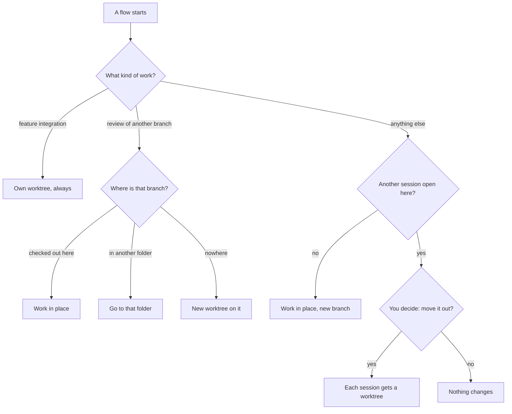

import { FileTree, Steps } from "@astrojs/starlight/components";

:::tip[TL;DR]
A worktree is a second desk: another folder with its own copy of the project, on its own branch, sharing one git history. superlite sets one up only when two pieces of work would collide, and for a feature's integration build.
:::



## How it works

Think of your project folder as a desk. A branch is the job laid out on it. Switching jobs means clearing the desk. A worktree gives you a second desk: git checks out another branch into another folder, and both desks share one history. Two chats can then work at once without touching each other's files.

By default superlite uses one desk. Sessions take turns in your main checkout. It adds a desk in two cases: a second chat starts while the first session is open, and a feature reaches its integration build. Worktrees live under `.claude/worktrees/`, which git never shows because superlite lists it in `.git/info/exclude`.

<FileTree>

- shop/  your main checkout
  - .claude/
    - worktrees/
      - sessions-export/  a session superlite moved out
      - sessions-login-fix/  a session superlite cut
      - export-int/  a feature's integration build
      - merge-main/  temporary, while shipping merges
  - .superlite/
    - sandboxes/  not worktrees: [prototype folders](/superlite/sessions/sandbox/)

</FileTree>

Older sessions may sit under `.superlite/worktrees/sessions/<slug>`. They keep working.

### The move question

When a new flow starts and your main checkout holds an open session, superlite does not touch that session on its own. It asks first, and changes nothing until you answer:

```text
ASK move slug=export: export moves from the main checkout to /work/shop/.claude/worktrees/sessions-export; its chat must be idle
```

- **Yes** moves `export`, with its run files and uncommitted work, into its own worktree. Your main checkout goes back to the base branch, and the new topic gets a worktree too. If anything fails, superlite puts everything back.
- **No** stops here. Nothing changes, and the new session does not start. Finish or close the open session, then start again.

Answer yes only when the first chat is idle, because its files move to a new folder. Before the move, superlite may ask what to do with untracked files: stash them with the session, or keep them in the main checkout.

If the open session is already on the base branch, it stays. The base branch cannot be checked out twice, so only the new session gets a worktree, and superlite asks nothing.

### The integration worktree

A feature runs twice. The prototype lives in a [sandbox](/superlite/sessions/sandbox/), a plain folder. After you approve it, the integration build gets its own worktree, named after the topic with `-int`. One feature, one worktree: never two features in one checkout.

### Entering a worktree under Claude Code

A new worktree is a different folder, so your chat has to step into it. Follow the line superlite prints:

<Steps>

1. `session: create EnterWorktree name=<n> base=<ref>`: Claude Code makes the worktree. Call `EnterWorktree name=<n>`, then rerun the same command inside it. superlite adopts the worktree.
2. `session: enter EnterWorktree path=<abs>`: superlite already cut it, for example because your main checkout is not on the base. Call `EnterWorktree path=<abs>`.
3. `ASK branch-name`: asked once. Keep Claude's `worktree-<slug>`, use `superlite/sessions/<slug>`, or give a pattern with `{slug}`.

</Steps>

Other tools: `cd` to the path on the `SESSION worktree=` line.

## Example: the integration build for a feature

```text
you        approve the prototype (it works)
superlite  session: create EnterWorktree name=export-int base=main
superlite  calls EnterWorktree name=export-int, then reruns superlite-cli session create --slug export-int --worktree inside it
superlite  ports the prototype's code into the real project, task by task
superlite  review, fixes, finish
superlite  deletes the sandbox, closes the session, leaves and removes the integration worktree
```

Without Claude Code, superlite cuts the folder itself, as `.claude/worktrees/sessions-export-int`.

## Good to know

- `session close` removes a worktree superlite cut. `ExitWorktree` only leaves it.
- A worktree Claude Code made ends with `ExitWorktree` set to `remove` or `keep`. `session close` only archives its run files.
- A review of another branch uses `superlite-cli session ensure --branch <target>`.
- Merging at shipping never switches your main checkout when it hosts another open session. superlite merges in a temporary `merge-<base>` worktree and removes it.

## Next

See how a session ends in [Session lifecycle](/superlite/sessions/lifecycle/), or read the [Feature flow](/superlite/flows/feature/).
