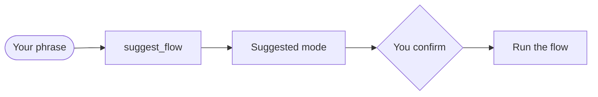

## What you do

Say what you want, or type a command. `/superlite:start` shows a menu with the suggestion first. A first word of regular, mvp, feature, debug, small, review or research skips the suggestion.

| Command | What it does |
|---|---|
| `/superlite:start [mode] [what]` | Menu: suggests a mode, you confirm and pick who orchestrates |
| `/superlite:mvp <what>` | Smallest working version on a clickable HTML prototype |
| `/superlite:feature <change>` | Change existing code: research, plan, prototype, integration |
| `/superlite:debug <bug>` | Root cause first, then a fix with a regression test |
| `/superlite:research <topic>` | Parallel agents, a sourced ledger, a report at your level |
| `/superlite:small <change>` | Small change inline with a reviewer |
| `/superlite:review [branch or path]` | Review and harden a branch |
| `/superlite:human` | You approve a review plan before any build |
| `/superlite:ai` | The AI plans, builds and decides on its own |
| `/superlite:approve [path]` | Approve the newest `docs/plans/*.review.md` if no path is given |
| `/superlite:status` | Mode, orchestrator, approval, progress, budget |
| `/superlite:stop` | Stop dispatching new tasks and report where the build stands |
| `/superlite:resume [plan path]` | Resume from the last checkpointed, tested wave |
| `/superlite:agents` | Open the agent map pane (needs the claude-agent-map mod) |
| `/superlite:tail` | The same run as a live terminal feed |
| `/superlite:report [plan name] [full]` | List stored build reports or show one |
| `/superlite:finish` | Verify with full tests, then offer merge or PR options |
| `/superlite:merged [slug\|branch\|PR]` | After the PR merges, close the session |
| `/superlite:setup` | First-run check |
| `/superlite:intro` | The intro screen |
| `/superlite:help [section]` | The detailed help |

## What superlite does

On a first message that names no mode and is not trivial, superlite runs `superlite-cli suggest_flow`. It prints one line: the flow, a reason and the flows that also fit. The same input gives the same line.

`/superlite:finish` never pushes without your explicit yes. `/superlite:merged` never pushes.

## Example

| Say something like | Flow |
|---|---|
| "Build me a static site generator from this spec" | MVP |
| "Add CSV export with column widths to the existing app" | Feature |
| "This test fails on leap days: find the root cause and fix it" | Debug |
| "Research the state of the art in vector search, for a VP" | Research |
| "Rename `build` to `render` everywhere" | Small |
| "Review this branch and fix what you find" | Review |
| "Build X. I will approve the plan" | Human orchestrator |
| "Build X. I am away, decide yourself" | AI orchestrator |
