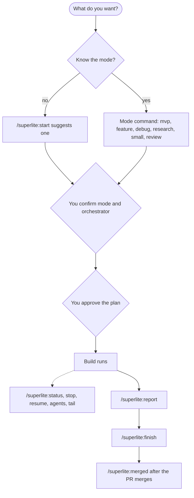

import { Steps } from "@astrojs/starlight/components";

:::tip[TL;DR]
Every command is a shortcut for something you can say in plain words. Start with `/superlite:start`, which suggests a mode. Use `/superlite:approve` to say yes to a plan, `/superlite:status` to look in, and `/superlite:finish` to ship.
:::



## How it works

You can type a command or say the same thing in words. A command skips the guessing. `/superlite:start` is the front door: it runs `superlite-cli suggest_flow` on your request, shows the suggested mode first and marked Recommended, then asks you to confirm it and pick who orchestrates.

A first word of regular, mvp, feature, debug, small, review or research skips the suggestion. For example, `/superlite:start debug the login test` goes straight to Debug and asks only who orchestrates. The suggestion is deterministic. The same input prints the same line.

## Command table

### Start a run

| Command | What it does |
|---|---|
| `/superlite:start [mode] [what]` | A menu: suggests a mode, you confirm and pick who orchestrates |
| `/superlite:mvp <what>` | Smallest working version, planned on a clickable HTML prototype |
| `/superlite:feature <change>` | Change existing code: research, a plan, a prototype you try, then the port |
| `/superlite:debug <bug>` | Root cause first, then a fix with a regression test |
| `/superlite:research <topic>` | Parallel researchers, a sourced ledger, a report at your level |
| `/superlite:small <change>` | A small change inline, with a reviewer |
| `/superlite:review [branch or path]` | Review and harden a branch; the current branch by default |

### Decide who orchestrates

| Command | What it does |
|---|---|
| `/superlite:human` | You approve a review plan before any build |
| `/superlite:ai` | The AI plans, builds and decides on its own |
| `/superlite:approve [path]` | Approve a review plan; the newest `docs/plans/*.review.md` if no path |

### During a build

| Command | What it does |
|---|---|
| `/superlite:status` | Mode, orchestrator, approval, progress, budget |
| `/superlite:stop` | Stop dispatching new tasks and report where the build stands |
| `/superlite:resume [plan path]` | Continue from the last checkpointed, tested wave |
| `/superlite:agents` | Open the agent map pane (needs the claude-agent-map mod) |
| `/superlite:tail` | The same run as a live terminal feed |

### After a build

| Command | What it does |
|---|---|
| `/superlite:report [plan name] [full]` | List stored reports, or show one |
| `/superlite:finish` | Verify with the full tests, then offer merge or PR options |
| `/superlite:merged [slug\|branch\|PR]` | After the PR merges: update local main, close the session |

### Setup and help

| Command | What it does |
|---|---|
| `/superlite:setup` | First-run check |
| `/superlite:intro` | The intro screen |
| `/superlite:help [section]` | The detailed help |

## Example: from a running build to a clean checkout

Say a build is running and you want to follow it, step away, ship it and clean up. Each step is one command. The last one is a real case: PR #57 added `/superlite:merged` itself.

<Steps>

1. **You look in.**

   ```text frame="terminal" title="Claude Code · superlite" ins={1}
   ❯ /superlite:status
   ```

   You get under 15 lines: the orchestrator, whether the plan is approved, tasks done, running and waiting, cost and time so far, and the next step. The command only reads. Nothing changes.

2. **You step away and come back.** **You decide:** stop, then resume when ready.

   ```text frame="terminal" title="Claude Code · superlite" ins={1,2}
   ❯ /superlite:stop
   ❯ /superlite:resume
   ```

   `/superlite:stop` dispatches nothing new, lets running agents finish and writes `.superlite/stopped.md`. `/superlite:resume` skips every task that is checkpointed and passing, and runs only the rest.

3. **You ship the work.** **You decide:** how.

   ```text frame="terminal" title="Claude Code · superlite" ins={1} mark={3}
   ❯ /superlite:finish
     1. Merge locally into the base branch
   › 2. Push and open a pull request
     3. Keep the branch as is
   ```

   It runs the full tests first, and a red result blocks the options. It never pushes without your yes.

4. **After the PR merges, you clean up.**

   ```text frame="terminal" title="Claude Code · superlite" ins={1}
   ❯ /superlite:merged 57
   ```

   superlite confirms the merge with `gh`, checks that the local branch holds nothing the PR lacks, closes the session, fast-forwards local `main` and deletes the local branch. It never pushes and never touches the remote branch.

   On GitHub the pull request shows as merged from the session branch into `main`.

</Steps>

**What you end up with:** the work merged, your checkout back on `main` and up to date, and no leftover session branch. For where each mode leads, see [Pick a flow](/superlite/flows/choose/).

## Good to know

- `/superlite:finish` never pushes or merges without your explicit yes. `/superlite:merged` never pushes.
- You do not have to type the word approve. superlite reads your reply, and any clear yes counts.
- `/superlite:agents` needs the mod. Without it, use `/superlite:tail`. See [Install](/superlite/start/install/).
- The `[ ]` in the table mark optional arguments.

## Next

[Concepts](/superlite/start/concepts/) explains the words these commands use. The [CLI reference](/superlite/reference/cli/) lists the `superlite-cli` tools underneath.
