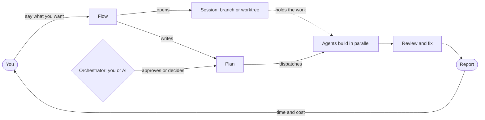

:::tip[TL;DR]
You pick a flow. superlite opens a session for it and writes a plan. An orchestrator, you or the AI, approves it. Agents build, reviewers check, and a report closes the run. Each idea below links to its full page.
:::



## How it works

Read the diagram left to right. Your request chooses a flow, the flow opens a session, and the plan is the contract between you and the build. The orchestrator is the one who says yes to the plan. The agents do the work inside the session. The report is how you find out what happened.

This page is the map. It does not explain each idea in full, so every row links to the one page that does.

## The pieces

| Concept | In one line | Read more |
|---|---|---|
| Flow | The path a request follows: MVP, Feature, Debug, Research, Small, Review or Regular. | [Pick a flow](/superlite/flows/choose/) |
| Session | One piece of work on its own branch, `superlite/sessions/<topic>`. Every run opens one. | [Sessions](/superlite/sessions/sessions/) |
| Worktree | A second folder with its own copy of the project, used when another run is open. | [Worktrees](/superlite/sessions/worktrees/) |
| Sandbox | A throwaway folder inside `.superlite/` where a feature prototype is built. | [Sandbox](/superlite/sessions/sandbox/) |
| Session lifecycle | How a session starts, runs, finishes and closes after the merge. | [Lifecycle](/superlite/sessions/lifecycle/) |
| Orchestrator | Who approves the plan and decides open choices: you (human) or the AI. | [Orchestrators](/superlite/run/orchestrators/) |
| Plan | What will be built, in plain words, with a rough time and cost. | [Plan and approval](/superlite/run/plan-and-approval/) |
| Agents | Workers on cheaper or stronger models, run side by side in waves. | [Parallel build](/superlite/run/parallel-build/) |
| Review and fixes | Reviewers check the work, fixers repair findings by tier. | [Reviews and fixes](/superlite/run/reviews-and-fixes/) |
| Report | Time and cost, projected against actual, and what changed from the plan. | [Report](/superlite/run/report/) |

## Example: one request through the map

Take the request "Add CSV export to the existing app". The right column names the concept at work.

```text
you        /superlite:feature Add CSV export
superlite  chooses the Feature flow                      flow
superlite  opens superlite/sessions/csv-export           session
superlite  writes a plan and asks for your yes           plan, orchestrator
you        approve
superlite  builds a prototype in .superlite/sandboxes    sandbox
you        it works
superlite  ports it into your code, tasks side by side   agents
superlite  checks the seams and fixes findings           review and fixes
superlite  shows time and cost                           report
```

The same shape holds for every flow. Only the middle changes: a bug flow finds the cause first, and a research flow fills a ledger instead of writing code.

## Good to know

- You do not create sessions or worktrees by hand. superlite opens them and picks the branch name.
- With the human orchestrator you see the plan first, which suits a first run. The AI orchestrator suits runs where you are away.
- A checkpoint is a hidden save of one finished task. Nothing is committed during a run.

## Next

Try it on [Quickstart](/superlite/start/quickstart/), or look up a command on [Commands](/superlite/start/commands/).
