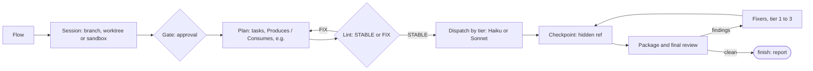

import { Steps } from "@astrojs/starlight/components";

:::tip[TL;DR]
A run lives in a session. Its plan is a task graph whose tasks declare what they produce, with exact examples. Lint makes tasks stable, a gate holds the build until approval, and agents on cheap or strong models build in parallel. Each task is checkpointed, reviewed, then fixed by tier. A report closes the run.
:::



## How it works

A run has three layers. **Where the work lives:** every flow opens a session, a branch plus run state in `.superlite/`. A worktree is used when the work needs its own folder, and a sandbox when a feature needs a throwaway prototype. **Who decides:** the orchestrator, you or the AI. Hooks enforce the decisions as gates, so a build cannot start, and a coordinator cannot edit code, just because a model says so. **How it is built:** the plan is a task graph. Lint checks every task before any agent starts. Agents build stable tasks in parallel, and each result is checkpointed, tested in the background and reviewed.

The plan carries most of the weight. Each task owns its files, names the interfaces it consumes, and states what it produces with `e.g.` examples. Those examples let a task build against another's contract before that code exists, which is why most of a graph starts at once.

## The pieces

**Where the work lives**

| Concept | What it is | Read more |
|---|---|---|
| Flow | The path a request takes: Regular, MVP, Feature, Debug, Small, Review or Research. Each fixes the steps and the plan format. | [Pick a flow](/superlite/flows/choose/) |
| Session | One piece of work: branch `superlite/sessions/<slug>` plus its run state. Two chats never share one. | [Sessions](/superlite/sessions/sessions/) |
| Worktree | A second checkout on its own branch, sharing one git history. Cut when two pieces of work would collide, and for a feature's integration build. | [Worktrees](/superlite/sessions/worktrees/) |
| Sandbox | A plain folder, `.superlite/sandboxes/<session>/<topic>/`, with no branch. It imports your real code in place and never edits tracked files. | [Sandbox](/superlite/sessions/sandbox/) |
| Lifecycle | Create, enter, finish, close. `session close` removes the worktree and keeps the branch for the PR. | [Lifecycle](/superlite/sessions/lifecycle/) |

**Who decides**

| Concept | What it is | Read more |
|---|---|---|
| Orchestrator | Human (you approve a review plan) or AI (it decides and records why). Neither pushes, merges or deletes on its own. | [Orchestrators](/superlite/run/orchestrators/) |
| Gate | A hook that blocks a tool call until a condition holds: approval newer than the plan, no code edits by the coordinator, tests only through `superlite-cli run_tests`. | [Gates](/superlite/reference/gates/) |
| Ruling | One line per decision made without you: `Ruling: [topic] choice - why - cost if wrong`. Listed in the closing message. | [Orchestrators](/superlite/run/orchestrators/) |
| FROZEN | An interface or test file the plan pins. No task may change it. | [Plan and approval](/superlite/run/plan-and-approval/) |
| Budget | A cost cap per run. `superlite-cli budget` warns at 70%. | [Gates](/superlite/reference/gates/) |

**How it is built**

| Concept | What it is | Read more |
|---|---|---|
| Review plan, machine plan | The short plan you approve, then the task graph agents run. | [Plan and approval](/superlite/run/plan-and-approval/) |
| Task | One agent's job: **Owns** (files), **Consumes**, **Produces** with `e.g.` lines, **Kind**, **Review Focus**. | [Plan and approval](/superlite/run/plan-and-approval/) |
| Task graph | Edge `Tn --> Tm` only when Tm's tests run Tn's code. An edge whose interfaces all have `e.g.` examples is not waited on. | [Parallel build](/superlite/run/parallel-build/) |
| Wave 0 | Manifest, inits, test config and a stub for every consumed interface, built first by `implementer-haiku`. | [Parallel build](/superlite/run/parallel-build/) |
| Lint | `superlite-cli plan_tools lint --stable` sorts tasks into STABLE and FIX, forecasts time and cost from history, and prints TIERS and DISPATCH NOW. | [Parallel build](/superlite/run/parallel-build/) |
| Tier | The model a task gets. `implementer` (Sonnet) by default, `implementer-haiku` only for `Kind: mechanical` tasks off the critical path. | [Agents](/superlite/reference/agents/) |
| Checkpoint | `superlite-cli checkpoint Tn` saves a task's own files under `refs/superlite/*`. Nothing is committed during a run. | [Parallel build](/superlite/run/parallel-build/) |
| Review and fixes | `package-reviewer` at checkpoint, one fresh `final-reviewer` on a review packet, then fixers from tier 1 (`fixer-sonnet`) to tier 3 (`fixer-opus`). | [Reviews and fixes](/superlite/run/reviews-and-fixes/) |
| Report | Projected against actual time and cost, the Rulings, and a history row that sharpens the next forecast. | [Report](/superlite/run/report/) |

## Example: one plan, traced through the concepts

Take the integration build from the [Feature flow example](/superlite/flows/feature/): idempotency keys on `POST /v1/payments` in `~/payments-api`, a FastAPI service on Postgres. The prototype is done and approved. Six tasks port it into `src/payments/`.

<Steps>

1. **Session and worktree.** The port gets its own folder and branch, so the sandbox and `main` stay untouched:

   ```bash title="~/payments-api"
   superlite-cli session create --slug idempotency-keys-int --worktree --base main
   ```

   The branch is `superlite/sessions/idempotency-keys-int`. The prototype's sandbox stays where it was, as a plain folder.

2. **The gate.** In human mode nothing is linted, dispatched or sent to an agent until you approve the review plan. Until then the hook refuses:

   ```text frame="terminal" title="Claude Code · ~/payments-api"
   BLOCKED: no human approval reply since the review plan was written; show the plan, ask the human to reply approve, end your turn
   ```

   You reply `approve`, and only then is the machine plan written. With the AI orchestrator, it decides and writes a `Ruling:` line instead.

3. **Tasks and contracts.** Each task declares what it produces, with examples another task can code against. T3 consumes T1's model and T2's fingerprint:

   ```md title="docs/plans/2026-11-25-idempotency-keys.md"
   ### T3 key store · Complexity 3 · Est. context 25k
   **Owns:** src/payments/idempotency/store.py, tests/idempotency/test_store.py
   **Kind:** design
   **Consumes:** models.IdempotencyKey(...) (T1) · fingerprint.of(method: str, path: str, body: bytes) -> str (T2)
   **Produces:** store.claim(s: AsyncSession, merchant_id: str, key: str, fp: str) -> Claim
     e.g. claim(s, "m_1", "k1", fp) on an empty table -> Claim.NEW
     e.g. claim(s, "m_1", "k1", other_fp) -> Claim.MISMATCH
   **Review Focus:** state: two `claim` calls on separate connections via `asyncio.gather` -> exactly one NEW, one IN_PROGRESS
   ```

   `Global constraints` pin `PaymentService.create` and `GatewayClient.charge` as FROZEN, so no task can change them to make its own tests pass.

4. **Task graph.** On paper the graph is a chain:

   ```text title="%% taskgraph"
   T1 --> T3
   T2 --> T3
   T3 --> T4
   T4 --> T5
   T5 --> T6
   ```

   A chain of six would take six rounds. Lint reads the contracts and drops the waits:

   ```text frame="terminal" title="Claude Code · ~/payments-api"
   EDGE: T3 does not wait for T1: every interface it takes from T1 has an e.g. example, so the edge is not waited on
   EDGE: T4 does not wait for T3: every interface it takes from T3 has an e.g. example, so the edge is not waited on
   EDGE: T6 does not wait for T5: every interface it takes from T5 has an e.g. example, so the edge is not waited on
   ```

5. **Lint, tiers and dispatch.** `superlite-cli plan_tools lint --stable` gives the verdict:

   ```text frame="terminal" title="Claude Code · ~/payments-api" mark={1,4,5}
   STABLE: T1 T2 T3 T4 T5 T6
   FIX:
   stats: n=83; predicted: 19.6 min, $0.47 (history-backed)
   TIERS: T1=sonnet T2=haiku T3=sonnet T4=sonnet T5=sonnet T6=sonnet
   DISPATCH NOW: T1 T2 T3 T4 T5 T6
   ```

   T2 is the only `Kind: mechanical` task, a pure function with exact inputs and outputs, so it goes to Haiku. The rest are design tasks on Sonnet. The forecast is drawn from history (`n=83`), not guessed.

6. **Checkpoints and review.** As each agent reports DONE, `superlite-cli checkpoint T3` saves only T3's own files to a hidden ref. A task that touched a file it does not own fails its checkpoint and goes back. T3's Review Focus names a race, so `package-reviewer` reviews it at checkpoint. T6, the seam check, reruns the five acceptance tests against the real `PaymentService` and Postgres. At the end, one `final-reviewer` reads `.superlite/review-packet.md` and returns tiered findings. Each finding goes to a fixer at the cheapest tier that fits.

7. **The report.** `superlite-cli finish --plan docs/plans/2026-11-25-idempotency-keys.md` archives the run and compares the 19.6-minute, $0.47 forecast with what happened. The actuals join the history the next forecast is drawn from. Then it asks you how to ship.

</Steps>

**What you end up with:** branch `superlite/sessions/idempotency-keys-int` with six checkpointed tasks, the 34 existing tests unchanged and green, a report, and no commits until you choose them at shipping.

## Good to know

- You do not create sessions, worktrees or sandboxes by hand. Flows open them; the command in step 1 is what the Feature flow runs for you.
- A task without `e.g.` examples on what it consumes really does wait. Examples are the cheapest way to make a plan faster.
- Gates are hooks, not instructions. A model cannot talk its way past one; the block message says what would unblock it.
- `/superlite:resume` restarts from the last checkpointed, tested wave, because checkpoints live outside your branch.

## Next

Try it on [Quickstart](/superlite/start/quickstart/), or look up a command on [Commands](/superlite/start/commands/).
