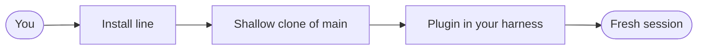

## What you do

Pick your harness, run its line, then open a fresh session. Install separately for each harness you use. Codex and Grok are unverified in the README.

| Harness | Install |
|---|---|
| Claude Code | `/plugin marketplace add iha2/superlite` then `/plugin install superlite@superlite-dev` |
| Antigravity | `agy plugin install https://github.com/iha2/superlite` |
| Codex (unverified) | `codex plugin marketplace add iha2/superlite`, then install Superlite from the plugin list |
| Cursor | `/add-plugin superlite` in Agent chat |
| Devin CLI | `devin plugins install iha2/superlite` |
| Factory Droid | `droid plugin marketplace add https://github.com/iha2/superlite` then `droid plugin install superlite@superlite-dev` |
| Gemini CLI | `gemini extensions install https://github.com/iha2/superlite` |
| GitHub Copilot CLI | `copilot plugin marketplace add iha2/superlite` then `copilot plugin install superlite@superlite-dev` |
| Grok Build CLI (unverified) | `grok plugin marketplace add iha2/superlite` then `grok plugin install superlite@superlite-dev --trust` |
| Kimi Code | `/plugins install https://github.com/iha2/superlite`, then `/new` |
| OpenCode | Tell it to fetch and follow `https://raw.githubusercontent.com/iha2/superlite/refs/heads/main/.opencode/INSTALL.md` |
| Pi | `pi install git:github.com/iha2/superlite` |
| Qwen Code | `qwen extensions install iha2/superlite` |
| Hermes Agent | `hermes plugins install iha2/superlite --enable`, then restart active sessions |
| Muse | `muse plugins install ./superlite` then `muse plugins approve superlite` |

## What superlite does

Each harness has a tool-mapping file in `skills/using-superlite/references/`. For Codex subagents, add `[features]` `multi_agent = true` to `~/.codex/config.toml`.

For the agent map pane in Claude Desktop, run `/plugin install claude-agent-map@superlite-dev`. Without it, use `/superlite:tail`.

## Example

Run `/superlite:setup` for the first-run check. It gives a pass or fix line for each item and changes nothing without your yes.

```text
claude --plugin-dir <path-to-superlite>
```

This loads the plugin for one session only.
