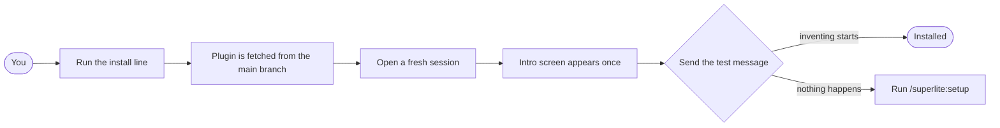

import { Steps, Aside } from "@astrojs/starlight/components";

:::tip[TL;DR]
Run your harness's install line, open a fresh session, then send one test message. Claude Code needs two commands. Install separately in each harness you use.
:::



## How it works

A harness is the tool that runs the model: Claude Code, Cursor, Gemini CLI and so on. superlite is a plugin, so each harness gets its own copy from the GitHub repository. The install line adds it to that harness only.

Open a fresh session after you install.

## Install

You need Claude Code, git, Python 3.12 or newer and `bash` (Git Bash on Windows). The tools are Python; the project you build can use any language. `uv` is optional.

<Steps>

1. Install the plugin. In Claude Code, run both lines:

   ```text
   /plugin marketplace add iha2/superlite
   /plugin install superlite@superlite-dev
   ```

2. Open a fresh session. The intro screen shows once.

3. Send the test message:

   ```text
   Let's make a react todo list
   ```

   A working install starts `inventing` before any code is written.

</Steps>

For one session only, load a local checkout: `claude --plugin-dir <path-to-superlite>`. For the agent map pane in Claude Desktop, add `/plugin install claude-agent-map@superlite-dev`. Without it, `/superlite:tail` prints the same run as a live feed.

## Other harnesses

| Harness | Install |
|---|---|
| Claude Code | `/plugin marketplace add iha2/superlite` then `/plugin install superlite@superlite-dev` |
| Antigravity | `agy plugin install https://github.com/iha2/superlite` |
| Codex (unverified) | `codex plugin marketplace add iha2/superlite`, then install Superlite from the plugin list |
| Cursor | `/add-plugin superlite` in Agent chat |
| Devin CLI | `devin plugins install iha2/superlite` |
| Factory Droid | `droid plugin marketplace add https://github.com/iha2/superlite` then `droid plugin install superlite@superlite-dev` |
| Gemini CLI | `gemini extensions install https://github.com/iha2/superlite` |
| GitHub Copilot CLI | `copilot plugin marketplace add iha2/superlite` then `copilot plugin install superlite@superlite-dev` |
| Grok Build CLI (unverified) | `grok plugin marketplace add iha2/superlite` then `grok plugin install superlite@superlite-dev --trust` |
| Kimi Code | `/plugins install https://github.com/iha2/superlite`, then `/new` |
| OpenCode | Tell it to fetch and follow `https://raw.githubusercontent.com/iha2/superlite/refs/heads/main/.opencode/INSTALL.md` |
| Pi | `pi install git:github.com/iha2/superlite` |
| Qwen Code | `qwen extensions install iha2/superlite` |
| Hermes Agent | `hermes plugins install iha2/superlite --enable`, then restart active sessions |
| Muse | `muse plugins install ./superlite` then `muse plugins approve superlite` |

Each harness has a tool-mapping file in `skills/using-superlite/references/`. It tells superlite which tool to call for each Claude Code tool name. Details per harness are on [Harnesses and install](/superlite/reference/harnesses/).

## Example: checking a fresh install

`/superlite:setup` is the first-run check. It gives one pass or fix line per item and changes nothing without your yes. The lines below are illustrative.

```text
you        /superlite:setup
superlite  project language and test command: pass, or fix
superlite  Python for the command line tools: pass, or fix
superlite  model tiers: pass, or fix
superlite  superpowers suspended during a run: pass, or fix
superlite  .superlite/ is gitignored: pass, or fix
you        yes, fix the gitignore line
superlite  applies only that fix
```

If the test message in step 3 does nothing, run this check first. Then confirm that you opened a new session after installing.

## Good to know

<Aside type="caution">
Codex and Grok are marked unverified in the README. For Codex subagents, add `[features]` and `multi_agent = true` to `~/.codex/config.toml`.
</Aside>

- The tool-mapping files cover Antigravity, Codex, Cursor, Gemini, Hermes, Muse, Pi and Claude Code.
- Where a harness has no plugin agents, each agent in `agents/` runs as the harness's generic subagent.

## Next

Run your [first build](/superlite/start/quickstart/), or read the [Concepts](/superlite/start/concepts/) map first.
