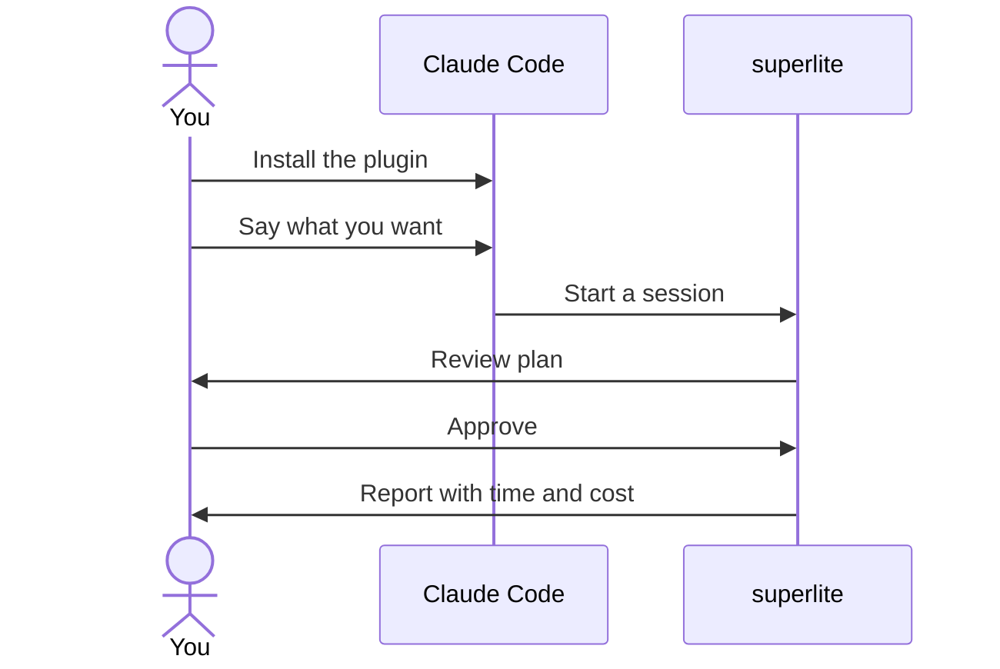

## What you do

1. Install the plugin in Claude Code.
2. Open a fresh session in your project.
3. Say what you want in plain words. Commands are shortcuts.
4. In human mode, read the review plan and reply approve.

You need Claude Code, git, Python 3.12 or newer and `bash`. The project you build can use any language.

## What superlite does

On your first message, superlite shows a one-screen intro. `/superlite:intro` brings it back, and `/superlite:help` has every detail.

It sizes the request and asks one batch of questions if the request is large. It also asks who orchestrates: you (human) or the AI.

Every run opens a [session](/superlite/sessions/sessions/): a branch `superlite/sessions/<topic>`, or a [worktree](/superlite/sessions/worktrees/) if another run is open. In human mode, nothing runs until you approve. superlite never commits during a run.

You can watch `.superlite/`: `progress.md`, `test-summary.json` and `metrics.jsonl`.

## Example

```text
/plugin marketplace add iha2/superlite
/plugin install superlite@superlite-dev
```

Open a fresh session and send this message:

```text
Let's make a react todo list
```

A working install starts `inventing` before any code is written. Then you see the review plan, and after you approve, the build and a report.

Next: [pick a flow](/superlite/flows/choose/) or see [all commands](/superlite/start/commands/).
