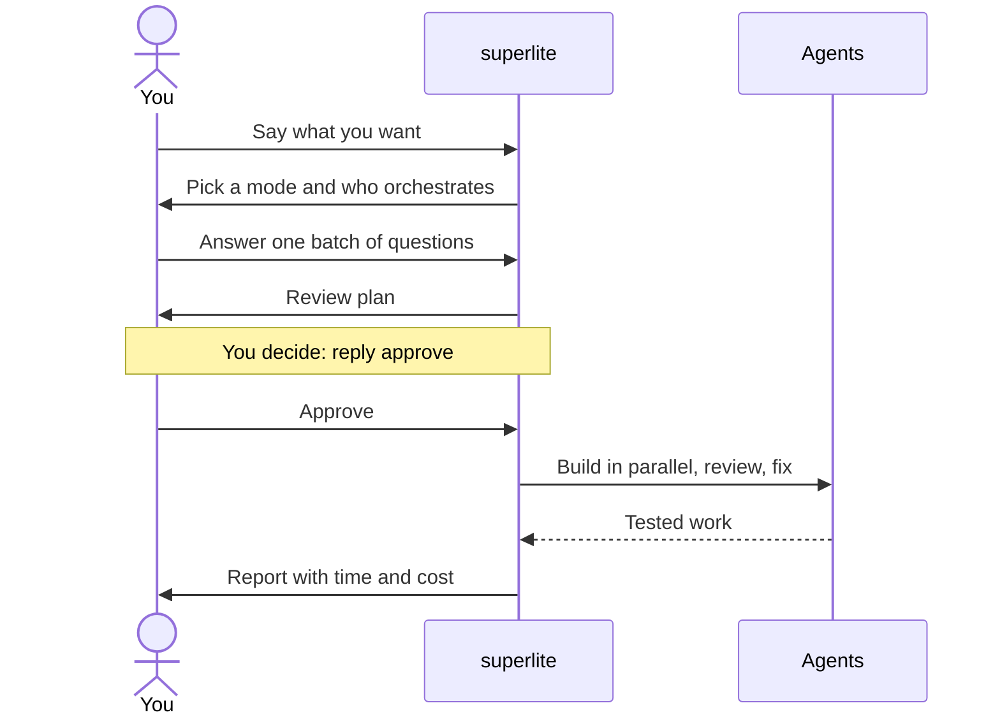
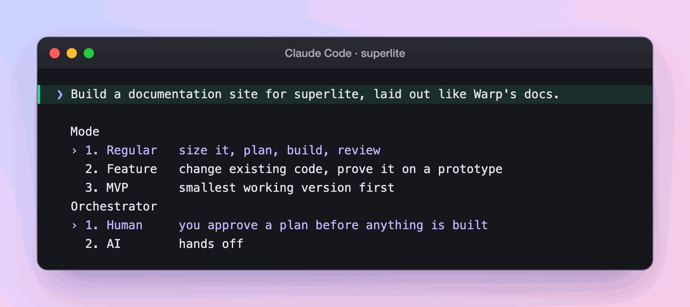
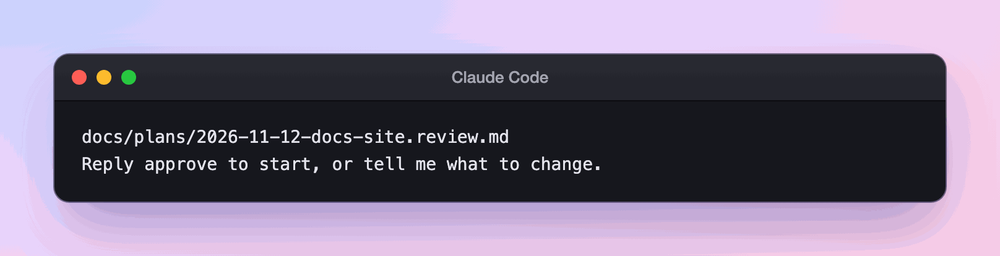
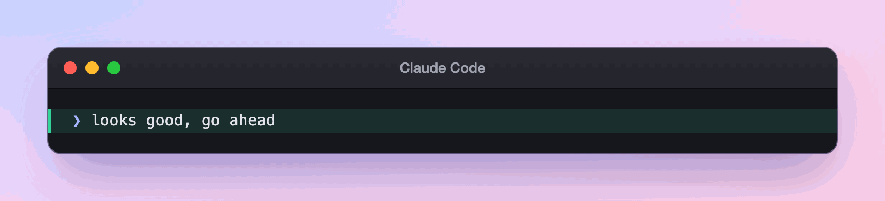
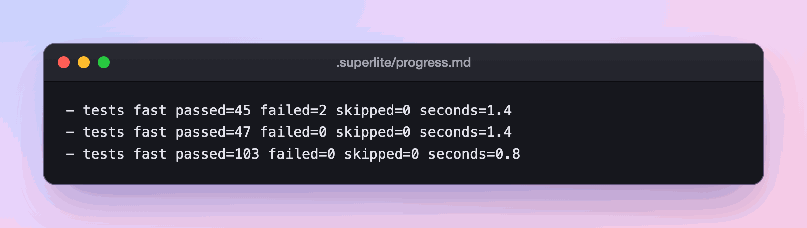
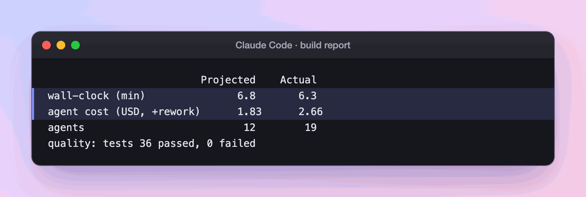
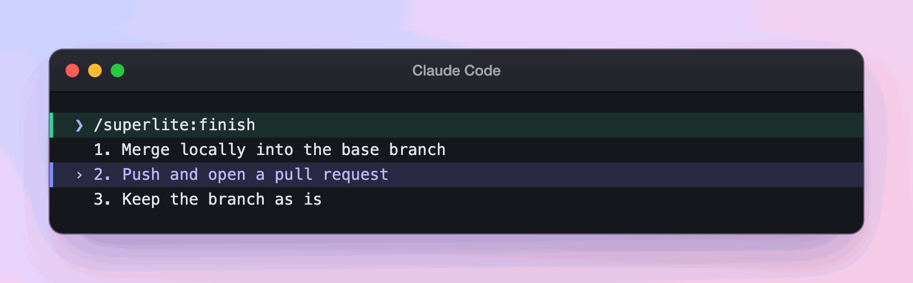
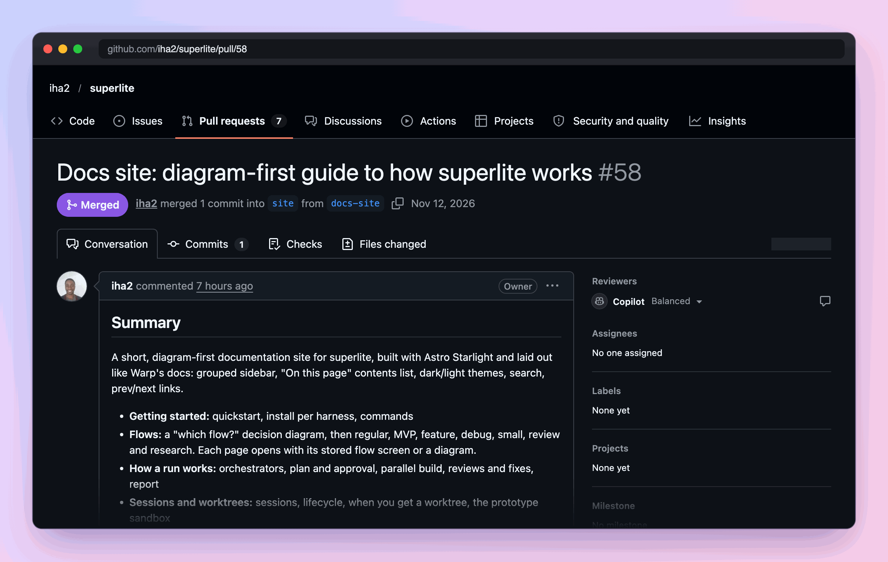

import { Steps, Aside, FileTree } from "@astrojs/starlight/components";

:::tip[TL;DR]
Install the plugin, open a fresh session in your project and say what you want. superlite writes a plan, you reply approve, and agents build, review and report.
:::



## How it works

You give superlite a request. It turns the request into a plan, waits for your yes, and then does the work without asking again. The plan is the one place where you steer. After you approve it, scope changes are recorded as rulings and listed at the end.

Nothing is committed during the run. superlite keeps each finished task as a hidden checkpoint and asks you once, at the end, what to do with the files. What each word means is on [Concepts](/superlite/start/concepts/).

## Do it

You need Claude Code, git, Python 3.12 or newer and `bash` (Git Bash on Windows). The project you build can use any language.

<Steps>

1. Install the plugin in Claude Code.

   ```text
   /plugin marketplace add iha2/superlite
   /plugin install superlite@superlite-dev
   ```

   Other tools are on [Install](/superlite/start/install/).

2. Open a fresh session in your project. The intro screen appears once. `/superlite:intro` shows it again.

3. Check the install. Send this message:

   ```text
   Let's make a react todo list
   ```

   A working install starts `inventing` before any code is written.

4. Pick a mode and who orchestrates. For a first run, choose Regular and the human orchestrator, so you see the plan before anything is built.

5. Answer the questions, then read the review plan and reply in your own words. Any clear yes counts.

6. Wait for the build, then read the report and run `/superlite:finish`. The example below walks through each of these steps.

</Steps>

## Example: building this docs site

This site was built with superlite, in the Regular flow with the human orchestrator. Here is that run, one screen at a time.

<Steps>

1. **You ask, then answer one menu.**

   

   `/superlite:start` runs `superlite-cli suggest_flow` on your words and the project, then asks both open questions in one menu, so you are interrupted once. **You decide:** the mode and who orchestrates. This run took Regular and Human.

2. **superlite shows the path and opens your workspace.**

   

   <FileTree>
   - .claude/worktrees/
     - sessions-docs-site/ branch superlite/sessions/docs-site
   </FileTree>

   A [session](/superlite/sessions/sessions/) opened, here as a [worktree](/superlite/sessions/worktrees/): a second folder on its own branch, so a second chat cannot overwrite this one. The request is large, so you get one batch of up to four questions. You answer once.

3. **You read the review plan.**

   ```md title="docs/plans/2026-11-12-docs-site.review.md" mark={4-5}
   # superlite docs site: review plan

   ## Decisions you can change
   - Where the site lives: its own `site` branch (default) | a separate repo `iha2/superlite-docs`.
   - Page length: about 300 words of prose per guide page (default) | stricter, 200.
   ```

   

   The plan is plain language for you. A second file, `docs/plans/2026-11-12-docs-site.md`, is the task list for the agents. superlite stops here: nothing is linted or sent to an agent until you answer. See [Plan and approval](/superlite/run/plan-and-approval/).

4. **You approve.** **You decide:** a clear yes is enough.

   

   Now lint reads the machine plan, 12 tasks, and saves a forecast: 6.8 minutes and $1.83 of agent cost. The forecast is fixed at this moment, so the report can later show where the run missed it.

5. **Agents build side by side.** Run `/superlite:status`, or watch the ledger.

   

   ```mermaid
   flowchart LR
     A["Wave 1: research, skeleton"] --> B["Wave 2: page writers"]
     B --> C["Wave 3: publish"]
   ```

   A task starts when the tasks it needs are done, so the writers waited for the fact sheets. Up to six agents ran at once, and the ledger shows tests going red, then green. See [Parallel build](/superlite/run/parallel-build/).

6. **You read the report.**

   

   It ran 7% faster than forecast, cost 45% more, and used 19 agents against 12 forecast, because the count includes reviewers and one rework dispatch. The coordinator, your own chat, cost $6.81 on top. Nothing is committed yet. See [Report](/superlite/run/report/).

7. **You ship it.** **You decide:** `/superlite:finish` runs the tests, then asks what to do with the work.

   

   Nothing is pushed without your yes. This run opened a pull request.

   

</Steps>

**What you end up with:** the branch `superlite/sessions/docs-site`, PR #58 merged into the `site` branch, and the plan and report in `docs/plans/`. What is left for you: take the review comments (Copilot's were applied in a follow-up commit), run `/superlite:merged` after a merge to clean up, and switch on GitHub Pages once (Settings, Pages, Source: GitHub Actions).

## Good to know

<Aside type="note">
superlite never pushes or merges without your explicit yes. When the session ends, it asks once: commit to the session branch, or leave the files uncommitted.
</Aside>

- Plain words work as well as commands. The commands are shortcuts: see [Commands](/superlite/start/commands/).
- Each run opens a session, a branch of its own, so two chats do not overwrite each other. See [Sessions](/superlite/sessions/sessions/).
- Say "I am away, decide yourself" and the AI orchestrator takes over: no review plan, no questions. See [Orchestrators](/superlite/run/orchestrators/).

## Next

[Concepts](/superlite/start/concepts/) maps the vocabulary. [Pick a flow](/superlite/flows/choose/) shows which mode fits a request. The [report](/superlite/run/report/) page explains the numbers at the end.
