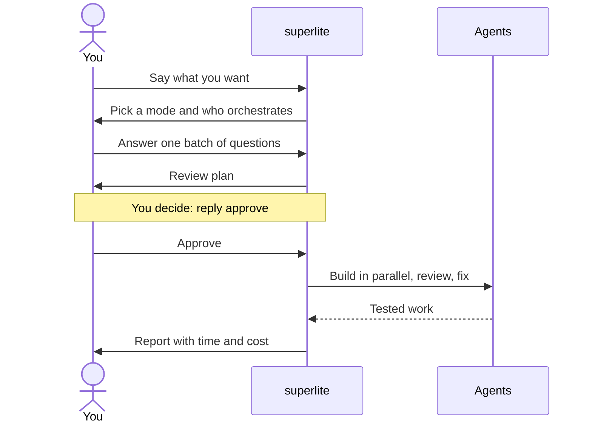

import { Steps, Aside } from "@astrojs/starlight/components";

:::tip[TL;DR]
Install the plugin, open a fresh session in your project and say what you want. superlite writes a plan, you reply approve, and agents build, review and report.
:::



## How it works

You give superlite a request. It turns the request into a plan, waits for your yes, and then does the work without asking again. The plan is the one place where you steer. After you approve it, scope changes are recorded as rulings and listed at the end.

Nothing is committed during the run. superlite keeps each finished task as a hidden checkpoint and asks you once, at the end, what to do with the files. What each word means is on [Concepts](/superlite/start/concepts/).

## Do it

You need Claude Code, git, Python 3.12 or newer and `bash` (Git Bash on Windows). The project you build can use any language.

<Steps>

1. Install the plugin in Claude Code.

   ```text
   /plugin marketplace add iha2/superlite
   /plugin install superlite@superlite-dev
   ```

   Other tools are on [Install](/superlite/start/install/).

2. Open a fresh session in your project. The intro screen appears once. `/superlite:intro` shows it again.

3. Check the install. Send this message:

   ```text
   Let's make a react todo list
   ```

   A working install starts `inventing` before any code is written.

4. Pick a mode and who orchestrates. For a first run, choose Regular and the human orchestrator, so you see the plan before anything is built.

5. Answer the questions, then read the review plan and reply in your own words. Any clear yes counts.

6. Wait for the build. To look in, run `/superlite:status`, or open `.superlite/progress.md` in your project.

7. Read the report, then run `/superlite:finish` to test and ship the branch.

</Steps>

## Example: a todo list, start to finish

The session below is illustrative. The `suggest:` line is what `superlite-cli suggest_flow` prints for an empty folder; the other superlite lines describe what happens.

```text
you        Let's make a react todo list
superlite  suggest: mvp - empty folder, a new idea, so try the smallest version first | also fits: regular
superlite  asks two things in one menu: which mode, who orchestrates
you        Regular, human orchestrator
superlite  opens a session on the branch superlite/sessions/todo-list
superlite  prints the ten-step Regular flow screen
superlite  asks one batch of up to 4 questions about what is still open
you        answers each, or accepts the recommended option
superlite  writes docs/plans/2026-11-12-todo-list.review.md
superlite  summary in five lines: "Reply approve to start, or tell me what to change"
you        looks good, go ahead
superlite  lints the plan, builds in parallel, reviews, fixes, runs tests
you        /superlite:status
superlite  orchestrator, approved or not, tasks done and running, cost and time so far
superlite  report: time and cost, projected vs actual. Nothing is committed.
you        /superlite:finish
superlite  runs the full tests, then offers merge or PR options
```

The mode menu suggested MVP. MVP adds a clickable prototype you try before the plan. Regular goes straight to the plan, which is why it suits a first run. See [MVP](/superlite/flows/mvp/) and [Regular](/superlite/flows/regular/).

## Good to know

<Aside type="note">
superlite never pushes or merges without your explicit yes. When the session ends, it asks once: commit to the session branch, or leave the files uncommitted.
</Aside>

- Plain words work as well as commands. The commands are shortcuts: see [Commands](/superlite/start/commands/).
- Each run opens a session, a branch of its own, so two chats do not overwrite each other. See [Sessions](/superlite/sessions/sessions/).
- Say "I am away, decide yourself" and the AI orchestrator takes over: no review plan, no questions. See [Orchestrators](/superlite/run/orchestrators/).

## Next

[Concepts](/superlite/start/concepts/) maps the vocabulary. [Pick a flow](/superlite/flows/choose/) shows which mode fits a request. The [report](/superlite/run/report/) page explains the numbers at the end.
