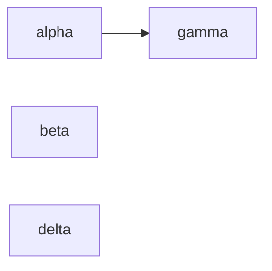
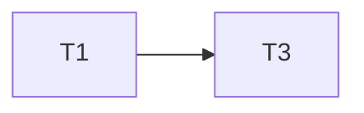

# Flow Plan

**Goal:** four tiny modules for the scenario harness.
**Architecture:** independent small modules; T3 reads T1.
**Tech stack:** Python 3.12, pytest.
**Target:** 20 min

## Main diagram

## Task graph

### T1 alpha · Complexity 2 · Est. context 20k
**Owns:** src/alpha.py, tests/test_alpha.py
**Est. time:** 1.0 min (1 component, about 20 LOC, tests: fast)
**Produces:** alpha() -> int
e.g. alpha() -> 1

### T2 beta · Complexity 2 · Est. context 20k
**Owns:** src/beta.py, tests/test_beta.py
**Est. time:** 1.0 min (1 component, about 20 LOC, tests: fast)
**Produces:** beta() -> int
e.g. beta() -> 2

### T3 gamma · Complexity 2 · Est. context 20k
**Owns:** src/gamma.py, tests/test_gamma.py
**Est. time:** 1.0 min (1 component, about 20 LOC, tests: fast)
**Consumes:** alpha() -> int
**Produces:** gamma() -> int
e.g. gamma() -> 3

### T4 delta · Complexity 2 · Est. context 20k
**Owns:** src/delta.py, tests/test_delta.py
**Est. time:** 1.0 min (1 component, about 20 LOC, tests: fast)
**Produces:** delta() -> int
e.g. delta() -> 4
