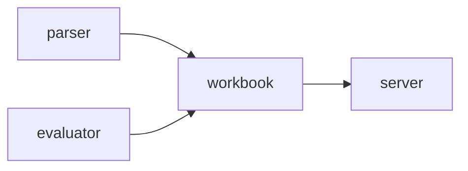
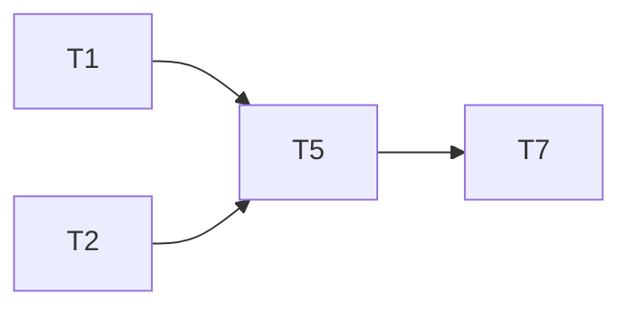

# Minisheet Plan
**Goal:** a small spreadsheet engine with a JSON server.
**Architecture:** parser and evaluator feed a workbook; the server wraps the workbook.
**Tech stack:** Python 3.12, pytest.
**Target:** 25 min

## Main diagram



## Task graph



### T1 evaluator · Complexity 4 (O-1) · Est. context 40k
**Owns:** src/minisheet/evaluator.py, tests/minisheet/test_evaluator.py
**Est. time:** 2.0 min (1 component, about 100 LOC, tests: fast)
**Produces:** evaluate(formula: str, get_cell) -> Value
e.g. evaluate("=1+2", get) -> Num(3.0)
**Notes:** never raises; parse and eval errors return ErrorValue('#VALUE!')
**Tests (verbatim):**
```python
def test_evaluate_error():
    assert evaluate("=1+", lambda ref: None) == ErrorValue("#VALUE!")
```

### T2 parser · Complexity 3 (O-2) · Est. context 38k
**Owns:** src/minisheet/parser.py, tests/minisheet/test_parser.py
**Est. time:** 1.8 min (1 component, about 80 LOC, tests: fast)
**Produces:** parse_ref(ref: str) -> tuple[int, int]
e.g. parse_ref("B2") -> (2, 2)
**Notes:** A1 maps to (0, 0); lower case is accepted

### T5 workbook · Complexity 5 (O-1) · Est. context 44k
**Owns:** src/minisheet/workbook.py, tests/minisheet/test_workbook.py
**Est. time:** 2.5 min (1 component, about 120 LOC, tests: slow)
**Consumes:** evaluate(formula: str, get_cell) -> Value (T1) · parse_ref(ref: str) -> tuple[int, int] (T2)
**Produces:** Workbook.set(ref: str, raw: str) -> list[str] · Workbook.get(ref: str) -> Value
e.g. Workbook.set("A1", "=1") -> ["A1"]
e.g. Workbook.get("A1") -> Num(1.0)
**Notes:** set returns every ref whose value changed

### T7 server · Complexity 5 (O-1) · Est. context 38k
**Owns:** src/minisheet/server.py, tests/minisheet/test_server.py
**Est. time:** 2.5 min (1 component, about 120 LOC, server tests: slow)
**Consumes:** Workbook.set(ref:str, raw:str)->list[str] (T5) · Workbook.get(ref)->Value (T5)
**Produces:** create_server(wb, port=0)->HTTPServer
**Notes:** unknown method returns 404 {"error":"not found"} (SPEC §10)

Ruling: sequential - the minisheet fixture is a deliberate chain
